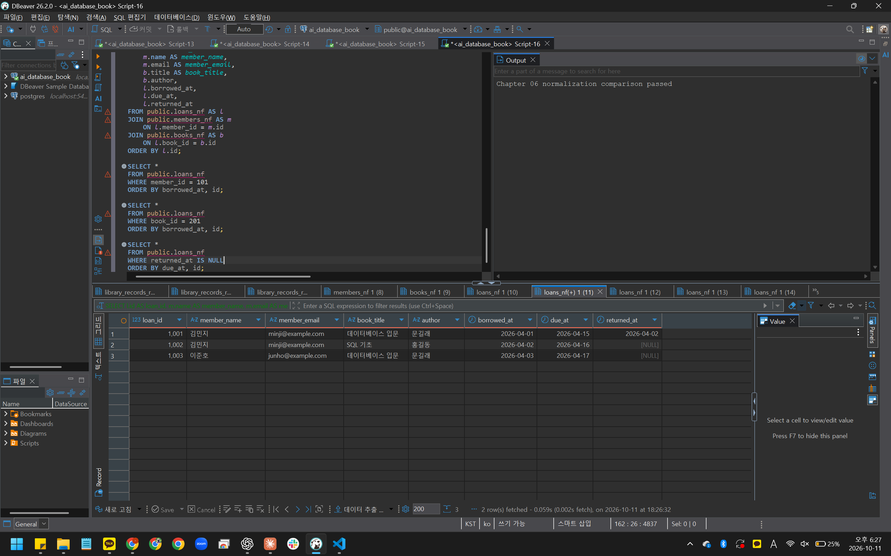
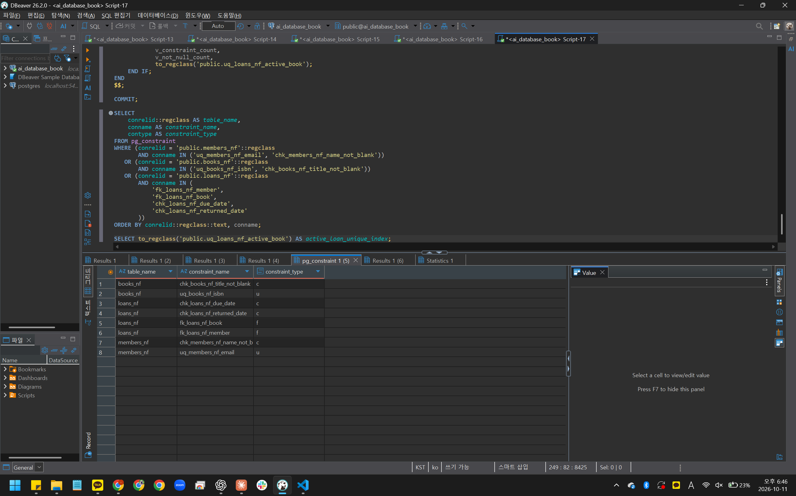
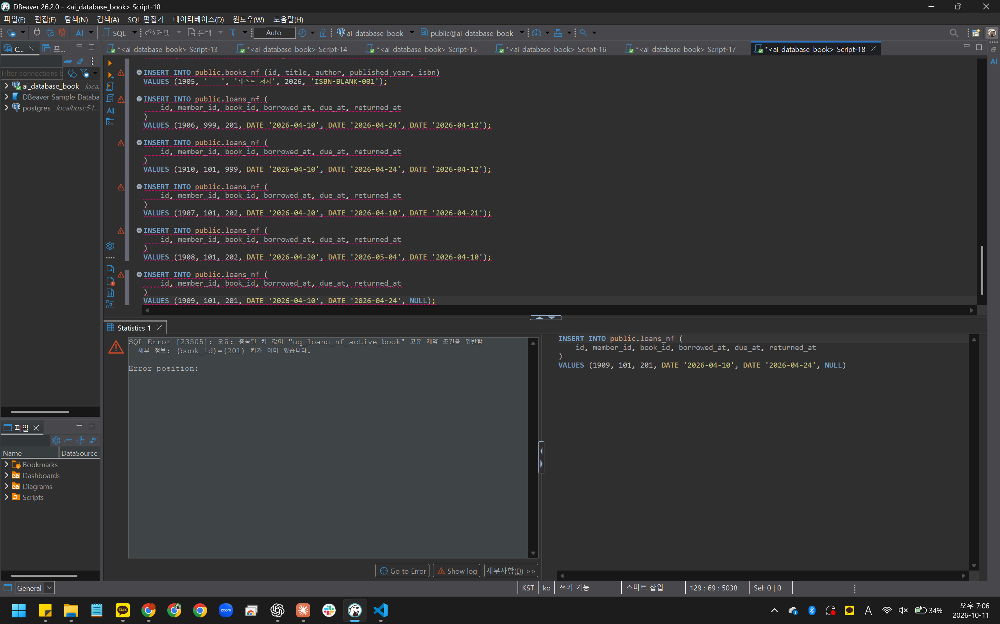
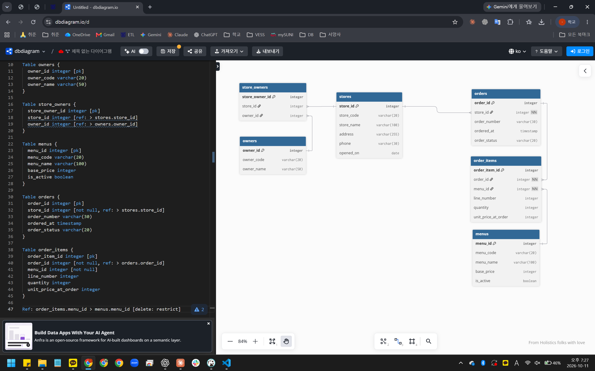

# Chapter 06 확장 실습 답안 템플릿

> **과제:** 정규화와 데이터 무결성으로 좋은 테이블 만들기  
> **사용 방법:** 이 파일을 내려받아 본인의 GitHub 저장소에 `chapter06_answer.md`라는 이름으로 저장한 뒤 실습하면서 바로 작성합니다.  
> **제출 방법:** LMS에는 파일을 직접 업로드하지 않고, **본인 GitHub 저장소의 `chapter06_answer.md` 파일 URL**을 제출합니다.

---

## 제출 전 주의

이 파일과 캡처 화면에는 실제 비밀번호, 전체 DB 접속 URL, API Key, 개인정보를 기록하지 않습니다.

```text
GitHub 계정 또는 별칭: rudah7725
과제 작성일: 2026-10-11
사용한 AI 도구: ChatGPT
```

---

# 1. 실습 환경과 시작 상태 확인

다음을 실행합니다.

```sql
SELECT current_database();
SELECT current_user;
SELECT current_schema();
SHOW search_path;
SHOW transaction_read_only;
```

| 확인 항목 | 실제 결과 | 의미 |
| --- | --- | --- |
| `current_database()` | ai_database_book | 실습용 DB에 제대로 연결되어 있다 |
| `current_user` | postgres | 테이블을 만들고 제약조건을 추가할 계정이다. 01~05를 모두 이 계정으로 실행한다 |
| `current_schema()` | public | 스키마를 생략하면 public에 객체가 만들어진다 |
| `search_path` | public, "$user" | 테이블 이름을 찾을 때 public부터 찾는다 |
| `transaction_read_only` | off | 읽기 전용이 아니라서 CREATE, ALTER를 실행할 수 있다 |

- [x] 현재 DB가 `ai_database_book`이다.
- [x] 변경 가능한 연결인지 확인했다.
- [x] Auto-commit 상태를 확인했다.
- [x] Chapter 06 번호형 SQL 파일을 사용한다.

---

# 2. 정규화 전 큰 테이블의 문제 찾기

본문의 `library_records_raw` 구조를 기준으로 생각합니다.

```text
library_records_raw 한 행
→ 대여 사건 한 건이지만 회원·도서의 현재 사실까지 함께 저장된 구조
```

## 2-1. 위험한 중복과 의미 있는 반복 구분

| 반복되는 값/상황 | 위험한 중복 / 의미 있는 반복 | 판단 이유 |
| --- | --- | --- |
| 회원 이메일이 여러 대여 행에 반복 | 위험한 중복 | 같은 회원의 현재 이메일이 대여 행마다 복사된 것이다. 이메일이 바뀌면 그 회원의 행을 모두 고쳐야 한다 |
| 도서 제목이 여러 대여 행에 반복 | 위험한 중복 | 도서의 현재 정보가 대여 건수만큼 복사된 것이다. 일부만 고치면 같은 책인데 제목이 서로 달라진다 |
| `loans_nf.member_id = 101` 반복 | 의미 있는 반복 | 행마다 서로 다른 대여 사건이고, 101은 회원을 가리키는 참조값일 뿐이다. 회원 정보 자체는 members_nf 한 곳에만 있다 |
| 사건 당시 가격 같은 이력값 반복 | 의미 있는 반복 (사건 당시 이력) | 그때의 값을 남기려는 것이라 현재 가격이 바뀌어도 고치면 안 된다. 값이 같아 보여도 사건마다 따로 기록된 것이다 |

## 2-2. 이상 현상 설명

### 삽입 이상

```text
아직 한 번도 대여되지 않은 새 도서를 등록하려 할 때 생기는 문제:
raw의 한 행은 대여 사건 한 건이고 기본키도 loan_id라서, 대여가 없는 책만 따로 넣을 자리가 없다. 넣으려면 대여일 칸을 비워 둔 가짜 대여 행을 만들어야 한다.
```

### 수정 이상

```text
회원 이메일이 변경될 때 생기는 문제:
김민지의 이메일은 1001, 1002 두 행에 있어서 두 행을 모두 고쳐야 한다. 한 행만 고치면 같은 회원에게 이메일이 두 개 생겨서 어느 쪽이 맞는지 알 수 없다.
```

### 삭제 이상

```text
마지막 대여 기록을 삭제할 때 생길 수 있는 문제:
SQL 기초는 1002 한 행에만 있다. 이 대여 기록을 지우면 SQL 기초라는 책과 저자 홍길동 정보까지 같이 사라진다.
```

### 왜 이것이 SQL 문법 문제가 아니라 구조 문제인가요?

```text
위의 INSERT, UPDATE, DELETE는 모두 오류 없이 실행된다. 문제는 한 행에 대여 사건과 회원, 도서의 현재 정보를 같이 담은 구조에 있어서, 실행은 성공해도 데이터의 의미가 깨질 수 있다.
```

---

# 3. 1NF·2NF·3NF 핵심 질문 복습

정규형 이름만 외우지 말고 **왜 분리하는지** 설명합니다.

## 3-1. 제1정규형(1NF)

```text
한 셀에 쉼표로 여러 독립 값을 넣거나 book1/book2/book3처럼 반복 열을 만들면 왜 문제가 되는가:
각 책을 따로 검색하거나 다른 테이블과 연결하거나 하나만 고치기가 어렵다. 반복 열은 책이 네 권이 되면 열을 새로 만들어야 하고, 빈 칸도 많이 생긴다.
```

내 서비스에서 비슷한 위험이 있는 예:

```text
주문 한 건에 메뉴를 불고기버거 2, 콜라 1처럼 한 칸에 몰아 적는 경우다. 이러면 메뉴별 판매량을 세거나 메뉴와 연결하기 어렵다. 그래서 Chapter 05에서 order_items로 메뉴 한 줄씩 나눠 저장했다.
```

## 3-2. 제2정규형(2NF)

다음 관계를 설명합니다.

```text
(student_id, course_id) → grade
student_id → student_name
course_id → course_name
```

```text
복합키 전체가 아니라 일부에만 의존하는 열을 분리해야 하는 이유:
grade는 학생과 과목 조합에 따라 정해지지만 student_name은 학생만 알면 정해진다. 수강 테이블에 이름을 두면 수강 과목 수만큼 같은 이름이 복사되고, 이름이 바뀔 때 여러 행을 고쳐야 한다. 그래서 이름은 students처럼 그 사실의 주인 테이블로 옮긴다.
```

## 3-3. 제3정규형(3NF)

```text
member_id → zip_code
zip_code → city
```

```text
일반 열이 다른 일반 열을 결정하는 구조를 검토해야 하는 이유:
city가 회원이 아니라 zip_code에 따라 정해진다면 같은 우편번호를 가진 회원마다 city가 복사된다. 한쪽만 고치면 같은 우편번호인데 도시가 다르게 저장될 수 있다.
```

### 정규화는 값이 반복되기만 하면 무조건 분리하는 것인가요?

```text
아니다. member_id처럼 관계를 나타내는 반복이나 주문 당시 단가 같은 이력은 분리하면 안 된다. 결정 관계가 실제 업무 규칙인지, 따로 관리해야 하는 사실인지, 바뀌는 이유와 시점이 다른지를 함께 보고 정한다.
```

---

# 4. 각 열의 '사실의 주인' 찾기

| 열 | 어떤 사실을 설명하는가 | 주인 테이블 | 이유 |
| --- | --- | --- | --- |
| `member_name` | 회원의 이름 | members_nf | 대여와 상관없이 회원이 정해지면 정해지는 현재 사실이다 |
| `member_email` | 회원의 연락 이메일 | members_nf | 회원 한 명에게 하나씩 있고, 바뀌면 한 곳만 고쳐야 한다 |
| `book_title` | 도서의 제목 | books_nf | 도서가 정해지면 정해지고, 대여 건수와 관계없다 |
| `author` | 도서의 저자 | books_nf | 도서를 설명하는 사실이다. 여러 저자는 이번 장에서 다루지 않아 한 열로 둔다 |
| `borrowed_at` | 이 대여가 시작된 날짜 | loans_nf | 같은 회원과 책이라도 대여할 때마다 달라지는 사건의 값이다 |
| `due_at` | 이 대여의 반납 예정일 | loans_nf | 대여 사건마다 정해진다 |
| `returned_at` | 이 대여의 실제 반납일 | loans_nf | 대여 사건마다 다르고, 반납 전에는 NULL이다 |
| `member_id` | 이 대여를 한 회원 | loans_nf (members_nf.id 참조) | 회원 정보를 복사하지 않고 누가 빌렸는지만 가리킨다 |
| `book_id` | 이 대여에서 빌린 도서 | loans_nf (books_nf.id 참조) | 도서 정보를 복사하지 않고 어떤 책인지만 가리킨다 |

정규화 후 한 행의 의미:

```text
members_nf 한 행 = 회원 한 명
books_nf 한 행 = 이 장에서 대여 대상으로 관리하는 도서 항목 한 건
loans_nf 한 행 = 특정 회원이 특정 도서를 대여한 사건 한 건
```

### 현재 사실과 사건 당시 이력을 구분하는 기준

```text
값이 바뀌었을 때 과거 기록도 같이 바뀌어야 하면 현재 사실이고, 그때 값 그대로 남아야 하면 사건 당시 이력이다. 회원 이메일은 바뀌면 지금 값으로 고치면 되지만, 대여일이나 Chapter 05의 주문 당시 단가는 나중에 바꾸면 안 된다.
```

---

# 5. PostgreSQL로 정규화 전·후 구조 재현

Public 저장소의 다음 파일을 순서대로 사용합니다.

```text
code/chapter06/01_normalization_schema.sql
code/chapter06/02_normalization_seed.sql
code/chapter06/03_normalization_compare.sql
```

## 5-1. `01_normalization_schema.sql`

실행 전 예상:

```text
생성될 테이블 수: 4개 (library_records_raw, members_nf, books_nf, loans_nf)
각 테이블 예상 행 수: 모두 0행
```

실행 후:

```text
실제로 생성된 테이블: library_records_raw, members_nf, books_nf, loans_nf (4개)
각 테이블 실제 행 수: raw 0, members 0, books 0, loans 0
```

## 5-2. `02_normalization_seed.sql`

실행 전 예상 기준:

```text
raw = 3
members = 2
books = 2
loans = 3
미반납 = 2
회원 101 대여 = 2
도서 201 대여 = 2
```

실제 결과:

```text
raw: 3
members: 2
books: 2
loans: 3
미반납: 2
회원 101 대여: 2
도서 201 대여: 2
```

예상과 다른 값이 있다면 이유:

```text
없다. 7개 값이 모두 예상 기준과 같았다.
```

## 5-3. `03_normalization_compare.sql`

```text
검증 메시지: Chapter 06 normalization comparison passed
PASS / FAIL: PASS
```

다음 항목을 확인합니다.

```text
회원 고아 참조: 0
도서 고아 참조: 0
날짜 순서 오류: 0
활성 대여 중복: 0
```

### 정규화 후에도 JOIN으로 원래 업무 정보를 다시 볼 수 있는 이유

```text
loans_nf에 member_id와 book_id가 남아 있어서, 이 값으로 members_nf와 books_nf를 연결하면 회원 이름, 이메일, 도서 제목, 저자를 다시 붙일 수 있다. 실제로 JOIN 결과 3행이 raw 테이블 3행과 같은 내용으로 나왔다.
```

### 증거 화면

권장 경로:

```text
assignments/chapter06/images/step05_normalization.png
```



---

# 6. Chapter 06에서 확정한 C-01~C-08 정책 해석

| ID | 확정 규칙 | 구현 방법 | 왜 필요한가 | Chapter 05에서는 왜 미확정이었나 |
| --- | --- | --- | --- | --- |
| C-01 | 이메일 문자열 중복 금지 | `UNIQUE` | 같은 이메일로 회원이 두 번 등록되면 누구의 기록인지 헷갈린다. 같은 문자열의 이메일이 두 번 들어오는 것을 막는다 | 이메일이 회원마다 달라야 하는지 정하지 않았다 (Q1). 샘플 값만 보고 고유하다고 정할 수 없었다 |
| C-02 | ISBN 필수·중복 금지 | `NOT NULL + UNIQUE` | 이번 실습에서 ISBN을 도서를 구별하는 업무 식별값으로 정했으므로, 비어 있거나 같은 값이 두 번 들어오면 안 된다 | 같은 ISBN의 복본을 어떻게 구분할지, ISBN 없는 책을 허용할지 정하지 않았다 (Q2). 그래서 NULL도 허용했다 |
| C-03 | 이름·제목 공백 금지 | `CHECK` | NOT NULL만 있으면 빈 문자열이나 공백만 있는 이름도 들어간다. 이름 없는 회원과 제목 없는 책을 막는다 | Chapter 05에서는 값이 있는지만 정했고, 공백까지 막을지는 다루지 않았다 |
| C-04 | `due_at >= borrowed_at` | `CHECK` | 반납 예정일이 대여일보다 앞서는 기록은 말이 안 된다. 날짜를 잘못 넣은 대여를 막는다 | 날짜 선후 규칙은 Chapter 06에서 보완하기로 남겨 두었다 |
| C-05 | `returned_at`은 NULL 또는 대여일 이상 | `CHECK` | 반납 전에는 NULL이어야 하지만, 반납했다면 대여일보다 앞일 수 없다. 대여 전에 반납한 기록을 막는다 | 반납일이 비어 있을 수 있다는 것만 정했고, 날짜 순서는 Chapter 06으로 미뤘다 |
| C-06 | 존재하는 회원·도서만 참조 | `FOREIGN KEY` | 없는 회원이나 없는 책을 가리키는 대여 기록이 생기면 누가 무엇을 빌렸는지 알 수 없다 | Chapter 05 loans에는 이미 FK가 있었다. 이번 실습 테이블은 정규화 전후를 비교하려고 FK 없이 만들었고, 기존 데이터를 검사한 뒤 다시 추가한다 |
| C-07 | 대여 이력이 있는 부모 삭제 금지 | `ON DELETE RESTRICT` | 대여 기록이 있는 회원이나 책을 지우면 그 기록이 고아가 되거나 이력이 사라진다 | 대여 기록이 있는 회원과 도서를 삭제할 수 있는지, 그때 기록을 어떻게 할지 정하지 않았다 (Q4) |
| C-08 | 도서당 미반납 대여 최대 한 건 | 부분 고유 인덱스 | 실제 책 한 권을 두 사람이 동시에 빌린 것처럼 기록되는 것을 막는다 | 같은 도서를 여러 명이 동시에 빌릴 수 있는지 정하지 않았다 (Q3). 복본 구분도 범위 밖이었다 |

### 확정되지 않은 정책을 제약조건으로 먼저 만들면 위험한 이유

```text
나중에 정책이 다르게 정해지면 정상 데이터가 들어가지 않거나, 이미 들어간 데이터 때문에 제약조건을 바꾸기 어려워진다. 예를 들어 ISBN에 UNIQUE를 먼저 걸면 같은 책의 복본을 등록할 수 없다. 제약조건은 정해진 규칙을 DB가 지키게 하는 것이지 미리 짐작해서 넣는 것이 아니다.
```

---

# 7. 기존 데이터 검사 후 무결성 규칙 적용

실행 파일:

```text
code/chapter06/04_add_integrity_rules.sql
```

## 7-1. 규칙을 추가하기 전에 기존 데이터를 먼저 검사해야 하는 이유

```text
이미 규칙에 어긋나는 데이터가 있으면 제약조건 추가 자체가 실패하거나, 어떤 행 때문에 실패했는지 찾기 어렵다. 04는 NULL, 중복, 공백, 날짜, 고아 참조, 활성 대여 중복을 먼저 세어 보고 모두 0일 때만 규칙을 추가하도록 되어 있다.
```

## 7-2. 실행 결과

```text
명명된 제약조건 개수: 8개 (UNIQUE 2, CHECK 4, FOREIGN KEY 2)
NOT NULL 적용 열 개수: 10개
부분 고유 인덱스 존재 여부: 있음 (uq_loans_nf_active_book)
COMMIT 성공 여부: 성공 (오류 없이 COMMIT 뒤의 확인 조회까지 실행됨)
```

### 메타데이터를 확인하는 이유

```text
ALTER TABLE이 오류 없이 끝났다는 것만으로는 원하는 규칙이 원하는 테이블에 붙었는지 알 수 없다. pg_constraint에서 이름과 종류를 직접 확인해야 실제로 적용됐다고 말할 수 있다.
```

### 증거 화면

권장 경로:

```text
assignments/chapter06/images/step07_constraints.png
```



---

# 8. 정상·경계·실패 테스트

실행 파일:

```text
code/chapter06/05_integrity_tests.sql
```

> **중요:** 오류 테스트는 한 번에 하나씩 실행하고, 각 테스트가 끝난 뒤 기준 데이터가 유지되는지 확인합니다.

## 8-1. 허용되어야 하는 경계값

최소 3개를 실행·관찰합니다.

| 테스트 | 예상 | 실제 | 왜 허용되어야 하는가 |
| --- | --- | --- | --- |
| `due_at = borrowed_at` | 성공 | 성공 (대여 1801 추가, 1행 반영) | 당일 반납 예정인 대여도 있을 수 있고, C-04는 대여일과 같거나 늦으면 된다 |
| `returned_at = borrowed_at` | 성공 | 성공 (같은 1801 행, 반납일도 2026-05-01) | 빌린 날 바로 반납하는 것도 정상적인 경우다 |
| `returned_at = NULL` | 성공 | 성공 (반납일이 NULL인 기존 대여 1002, 1003이 04에서 CHECK를 추가할 때 통과함) | 아직 반납하지 않은 대여는 반납일이 비어 있어야 한다 |
| `published_year = NULL` | 성공 | 성공 (도서 1802 추가, 1행 반영) | 출판연도는 필수값이 아니라서 모르면 비워 둘 수 있다 |
| 공백이 아닌 한 글자 이름 | 성공 | 성공 (이름이 김인 회원 1803 추가, 1행 반영) | 공백만 아니면 되고 이름 길이를 제한하는 규칙은 없다 |

## 8-2. 실패해야 하는 오류값

최소 6개를 실행합니다.

| 오류 테스트 | 기대 규칙 | 실제 결과 | 오류 메시지 핵심 | 실패해야 하는 이유 |
| --- | --- | --- | --- | --- |
| 필수값 NULL | `NOT NULL` | 실패 (23502) | name 열의 null 값이 not-null constraint 위반 | 회원 이름은 꼭 있어야 하는 값이다 |
| ISBN NULL | `NOT NULL` | 실패 (23502) | isbn 칼럼의 null 값이 not null 제약조건 위반 | C-02에서 ISBN을 필수로 정했다 |
| 이메일 중복 | `UNIQUE` | 실패 (23505) | uq_members_nf_email 위반, junho@example.com 이미 있음 | C-01, 같은 이메일로 회원이 둘 생기면 안 된다 |
| ISBN 중복 | `UNIQUE` | 실패 (23505) | uq_books_nf_isbn 위반, ISBN-001 이미 있음 | C-02, ISBN이 같으면 도서를 구분할 수 없다 |
| 공백 이름/제목 | `CHECK` | 둘 다 실패 (23514) | chk_members_nf_name_not_blank, chk_books_nf_title_not_blank 위반 | C-03, 공백만 있으면 사실상 값이 없는 것과 같다 |
| 존재하지 않는 회원 | `FOREIGN KEY` | 실패 (23503) | fk_loans_nf_member 위반, member_id 999 없음 | C-06, 없는 회원의 대여 기록이 생기면 안 된다 |
| 존재하지 않는 도서 | `FOREIGN KEY` | 실패 (23503) | fk_loans_nf_book 위반, book_id 999 없음 | C-06, 없는 책을 빌린 기록이 생기면 안 된다 |
| 날짜 순서 위반 | `CHECK` | 둘 다 실패 (23514) | chk_loans_nf_due_date, chk_loans_nf_returned_date 위반 | C-04, C-05, 대여일보다 앞선 예정일과 반납일은 말이 안 된다 |
| 두 번째 미반납 대여 | 부분 고유 인덱스 | 실패 (23505) | uq_loans_nf_active_book 위반, book_id 201 이미 있음 | C-08, 도서 201은 1003번 대여가 아직 반납되지 않았다 |
| 참조 중 부모 삭제 | `RESTRICT/FK` | 실패 (23001) | RESTRICT fk_loans_nf_member 위반, id 101이 loans_nf에서 참조됨 | C-07, 회원 101의 대여 기록 2건이 남아 있다 |

## 8-3. 테스트 후 기준 상태 재검증

```text
raw: 3
members: 2
books: 2
loans: 3
미반납: 2
회원 고아 참조: 0
도서 고아 참조: 0
활성 대여 중복: 0
```

### 실패 테스트 후 기준 데이터가 유지되어야 하는 이유

```text
오류가 난 SQL이 데이터를 일부라도 남기면 다음 테스트 결과를 믿을 수 없다. 실패한 문장이 아무것도 바꾸지 않았다는 것까지 확인해야 제약조건이 데이터를 지켰다고 말할 수 있다.
```

### 증거 화면

권장 경로:

```text
assignments/chapter06/images/step08_integrity_error.png
```



---

# 9. 정규화와 무결성 제약조건 역할 비교

| 질문 | 나의 설명 |
| --- | --- |
| 정규화가 해결하는 문제 | 같은 사실이 여러 행이나 테이블에 복사되지 않게 사실의 주인을 정한다. 그래서 수정, 삽입, 삭제 이상이 줄어든다 |
| `NOT NULL`이 해결하는 문제 | 꼭 있어야 하는 값이 비어 있는 행을 막는다. 이름이나 ISBN이 없는 행이 들어오지 않는다 |
| `UNIQUE`가 해결하는 문제 | 하나만 있어야 하는 값이 두 번 들어오는 것을 막는다. 같은 이메일의 회원, 같은 ISBN의 도서가 그 예다 |
| `CHECK`가 해결하는 문제 | 한 행 안에서 값이 규칙에 맞는지 검사한다. 공백만 있는 이름이나 대여일보다 앞선 반납일을 막는다 |
| `FOREIGN KEY`가 해결하는 문제 | 없는 회원이나 도서를 가리키는 대여 기록을 막고, 참조 중인 부모가 지워지지 않게 한다 |
| 부분 고유 인덱스가 해결하는 문제 | 특정 조건의 행에서만 중복을 막는다. 미반납 대여만 골라 도서당 한 건으로 제한하고, 반납한 이력은 여러 건 남길 수 있다 |

### 정규화만 잘하면 잘못된 데이터가 모두 차단되나요?

```text
아니다. 정규화는 사실을 어느 테이블에 둘지 정할 뿐이다. 반납일이 대여일보다 앞서거나 같은 이메일이 두 번 들어오는 것은 구조만으로는 막지 못한다. 실제로 01과 02 단계의 테이블에는 PK만 있고 이메일 중복이나 날짜 순서를 검사하는 제약조건은 없었다. 04에서 규칙을 추가한 뒤에야 8번 테스트에서 이런 값이 막혔다.
```

### 제약조건만 많이 넣으면 나쁜 구조가 좋은 구조가 되나요?

```text
아니다. raw 테이블처럼 회원 이메일이 대여 행마다 복사된 구조에 제약조건을 아무리 넣어도, 이메일이 바뀌면 여러 행을 고쳐야 하는 문제는 그대로 남는다. 오히려 확정되지 않은 규칙까지 넣으면 정상 데이터가 막힐 수 있다. 구조를 먼저 바로잡고, 확정된 규칙만 제약조건으로 넣어야 한다.
```

---

# 10. Chapter 05 개인 ERD 개선

Chapter 05에서 만든 개인 서비스 ERD를 다시 엽니다.

## 10-1. 수정 전 점검

- [ ] 같은 현재 사실을 여러 테이블에 복사한 부분이 있는가?
- [ ] 한 셀에 여러 독립 값을 넣으려 한 부분이 있는가?
- [ ] 사건과 현재 상태가 한 테이블에 섞였는가?
- [ ] 복합키 일부에만 의존하는 속성이 있는가?
- [ ] 일반 열이 다른 일반 열을 결정하는 부분이 있는가?
- [x] 확정 업무 규칙인데 DB가 막지 못하는 부분이 있는가?
- [ ] 아직 미확정인데 제약조건으로 너무 강하게 정한 부분이 있는가?

## 10-2. 수정 전·후 비교

| 항목 | 수정 전 | 수정 후 | 변경 근거 | 관련 요구사항 ID |
| --- | --- | --- | --- | --- |
| 주문의 가맹점 참조 | orders.store_id FK만 있고 NULL 허용 | orders.store_id에 NOT NULL 추가 | 주문은 반드시 가맹점 한 곳에서 발생하는데, NULL이면 어느 가맹점 주문인지 모르는 행이 생긴다 | P05-R04 |
| 주문 항목의 주문, 메뉴 참조 | order_items.order_id, menu_id NULL 허용 | 둘 다 NOT NULL 추가 | 주문 항목은 반드시 주문 한 건에 속하고 메뉴 한 개를 가리켜야 한다 | P05-R05, P05-R06 |
| 메뉴 삭제 규칙 | 삭제 규칙 없음 | order_items.menu_id 참조에 ON DELETE RESTRICT | 과거 주문의 메뉴 정보가 남아야 하므로 주문된 메뉴는 지우지 않고 is_active로 판매 중지만 표시한다 | P05-R09 |

## 10-3. 개인 프로젝트 무결성 규칙 후보

| 규칙 ID | 업무 규칙 | 제약조건 후보 | 확정 / 미확정 | 근거 |
| --- | --- | --- | --- | --- |
| P06-C01 | 주문은 존재하는 가맹점에서만 발생한다 | orders.store_id NOT NULL + FK | 확정 | P05-R04 |
| P06-C02 | 주문 항목은 존재하는 주문과 메뉴를 가리킨다 | order_items.order_id, menu_id NOT NULL + FK | 확정 | P05-R05 |
| P06-C03 | 주문된 적 있는 메뉴는 삭제하지 않는다 | FK ON DELETE RESTRICT | 확정 | P05-R09 |
| P06-C04 | 메뉴 코드와 점주 코드는 중복되지 않는다 | UNIQUE (menu_code), UNIQUE (owner_code) | 미확정 (확인 필요) | 요구사항에 중복 금지가 직접 적혀 있지 않음 |
| P06-C05 | 수량은 1 이상, 가격은 0 이상이다 | CHECK (quantity >= 1), CHECK (base_price >= 0) 등 | 미확정 (확인 필요) | P05-R03, R05, R07에 값의 범위가 없음 |

> 미확정 규칙은 `확인 필요`로 남겨도 됩니다. 억지로 제약조건을 만들지 않습니다.

## 10-4. 수정한 ERD

권장 이미지 경로:

```text
assignments/chapter06/images/step10_my_erd_after.png
```



---

# 11. AI를 정규화·무결성 리뷰어로 활용

## 11-1. 내가 먼저 작성한 구조와 규칙

```text
내 서비스: 외식업 가맹점 운영 관리 서비스
검토할 테이블: stores, owners, store_owners, menus, orders, order_items
한 행의 의미: stores 가맹점 한 곳, owners 점주 한 명, store_owners 점주와 가맹점의 운영 관계 한 건, menus 메뉴 한 개, orders 주문 한 건, order_items 주문 상세 한 줄
중복으로 의심되는 열: order_items.unit_price_at_order. menus.base_price와 값이 같을 수 있지만 주문 당시 가격이라 이력으로 남긴다
확정 업무 규칙: P06-C01 주문은 존재하는 가맹점에서만 발생, P06-C02 주문 항목은 존재하는 주문과 메뉴를 가리킴, P06-C03 주문된 메뉴는 삭제하지 않음
미확정 정책: P06-C04 코드 중복 금지, P06-C05 수량과 가격 범위, P05-Q01~Q05
```

## 11-2. AI에게 전달한 핵심 프롬프트

```text
데이터베이스 수업에서 정규화랑 무결성 제약조건을 배우고 있어. 외식업 가맹점 운영 관리 서비스 데이터 모델인데, 새로 설계하지 말고 리뷰만 해 줘.
1. 각 열이 맞는 테이블에 있는지, 반복되는 값이 위험한 중복인지 관계 표현인지 주문 당시 이력인지 구분해 줘.
2. 1NF, 2NF, 3NF 문제가 있다고 보면 어떤 결정 관계 때문인지 같이 설명해 줘.
3. 제약조건은 내가 확정한 규칙에 대해서만 제안하고, 미확정인 건 확인 질문으로 남겨 줘.
4. ON DELETE CASCADE를 말하려면 삭제해도 되는 근거부터 물어봐 줘.
5. 정상값, 경계값, 실패값 테스트 아이디어도 하나씩 알려 줘.

테이블:
stores 가맹점 한 곳: store_id PK, store_code, store_name, address, phone, opened_on
owners 점주 한 명: owner_id PK, owner_code, owner_name
store_owners 점주와 가맹점의 운영 관계 한 건, 공동 운영을 허용할 때의 안: store_owner_id PK, store_id FK, owner_id FK
menus 메뉴 한 개: menu_id PK, menu_code, menu_name, base_price, is_active
orders 주문 한 건: order_id PK, store_id FK NOT NULL, order_number, ordered_at, order_status
order_items 주문 상세 한 줄: order_item_id PK, order_id FK NOT NULL, menu_id FK NOT NULL ON DELETE RESTRICT, line_number, quantity, unit_price_at_order

확정 규칙:
C01 주문은 존재하는 가맹점에서만 발생한다.
C02 주문 항목은 존재하는 주문과 메뉴를 가리킨다.
C03 주문된 적 있는 메뉴는 삭제하지 않고 is_active로 판매 중지만 표시한다.

확인 필요:
C04 메뉴 코드, 점주 코드 중복 금지
C05 수량 1 이상, 가격 0 이상
Q01 공동 운영이나 여러 매장 운영을 허용하나?
Q02 가맹점 코드는 바뀌거나 다시 쓸 수 있나?
Q03 매출에 어떤 주문을 넣나? 결제, 환불은?
Q04 매출 기간은 주문일 기준인가 결제일 기준인가?
Q05 판매 중지 메뉴를 새 주문에서 막을 건가?
```

## 11-3. AI 제안 검토

| AI 제안 | 수용 / 수정 / 보류 / 거절 | 요구사항 근거 | 실제 검증 방법 | 나의 판단 |
| --- | --- | --- | --- | --- |
| 주문 항목을 삭제할 수 있으면 메뉴를 가리키는 참조가 사라져 C03의 RESTRICT가 소용없어지므로, 주문과 주문 항목의 삭제 허용 여부부터 정해야 한다 | 수용 | P05-R09, P06-C03 | 지금은 8번의 회원 101 삭제 테스트처럼 주문 항목이 남아 있을 때 메뉴 삭제가 거절되는지만 확인할 수 있다. 주문 항목을 지운 뒤에도 과거 메뉴가 보호되는지는 삭제 정책이 정해진 뒤 검증한다 | 놓친 부분이 맞다. 주문 삭제 허용 여부를 확인 질문으로 추가한다 |
| menu_code, owner_code의 유일 범위가 전체인지 매장별인지 확인해야 한다 | 보류 | P05-R02, P05-R03, P06-C04 | 정책이 정해지면 같은 코드를 두 번 넣는 실패 테스트로 확인 | 본사가 관리한다는 것만으로 범위를 정할 수는 없다. 중복 금지 여부와 함께 확인 필요로 남긴다 |
| quantity 1 이상, base_price와 unit_price_at_order 0 이상을 규칙으로 확정하는지 확인해야 한다 | 보류 | P05-R03, R05, R07에 값의 범위가 없음 | 확정되면 수량은 1을 허용 경계값, 0을 실패값으로, 가격은 0을 허용 경계값, 음수를 실패값으로 테스트 | 10-3에서 P06-C05를 확인 필요로 둔 것과 같다 |
| 메뉴가 모든 매장에 공통으로 적용되는지 확인해야 한다 | 수정 | P05-R03 (매장별 메뉴에 대한 내용 없음) | 요구사항 문장을 다시 확인 | 현재 초안은 본사 공통 메뉴로 가정한다고 적고, 매장별 차이는 확인 질문으로 남긴다. 지금 테이블을 새로 나누지는 않는다 |
| (order_id, line_number)를 후보키로 정하면 부분 종속을 다시 살펴봐야 한다 | 보류 | P05-R05 | 후보키를 정하면 order_items의 열이 두 열 전체에 종속되는지 확인 | Chapter 05에서도 이 조합의 중복 금지는 보류했다. 지금 확인한 결정 관계에서는 부분 종속이 없지만, 후보키가 확정되면 다시 검토한다 |

특히 AI가 다음을 제안했다면 근거를 다시 확인합니다.

```text
UNIQUE
NOT NULL
CHECK
ON DELETE CASCADE
ON DELETE RESTRICT
새로운 테이블 분리
```

### AI가 단순히 값이 반복된다는 이유만으로 분리를 제안한 부분이 있었나요?

```text
없었다. store_owners와 orders의 ID 반복은 관계 표현으로, unit_price_at_order는 menus.base_price와 다른 주문 당시 이력으로 구분했다.
```

### AI가 미확정 정책을 확정 규칙처럼 만든 부분이 있었나요?

```text
없었다. 코드 중복 금지, 수량과 가격 범위, Q01~Q05를 모두 확인 질문으로 남겼고 CASCADE도 근거가 없다며 제안하지 않았다.
```

---

# 12. 최종 성찰

아래 문장은 본인의 말로 작성합니다.

```text
1. 정규화에서 가장 중요한 질문은
   이 값이 누구에 대한 사실이고, 어느 테이블 한 곳에서 관리해야 하는가 이다.

2. 위험한 중복과 의미 있는 반복의 차이는
   값이 바뀔 때 여러 행을 같이 고쳐야 하는 복사본인지, 행마다 다른 사건을 가리키는 관계나 그때의 기록인지 이다.

3. 정규화와 제약조건의 역할이 다른 이유는
   정규화는 사실을 어디에 둘지 정하는 것이고, 제약조건은 정해진 규칙에 맞지 않는 값이 들어오지 못하게 막는 것이기 때문 이다.

4. 실패해야 하는 SQL을 일부러 실행해 보는 이유는
   규칙을 만들었다는 것만으로는 부족하고, 잘못된 값이 실제로 막히는지와 기존 데이터가 그대로 남는지를 직접 확인해야 하기 때문 이다.

5. AI가 제안한 UNIQUE/CHECK/FK를 그대로 적용하면 안 되는 이유는
   요구사항에 없는 규칙이 섞여 있으면 정상 데이터까지 막을 수 있어서, 근거가 있는지 먼저 확인해야 하기 때문 이다.
```

---

# 13. 제출 체크리스트

- [x] `chapter06_answer.md`를 본인 저장소에 만들었다.
- [x] 위험한 중복과 의미 있는 반복을 구분했다.
- [x] 삽입·수정·삭제 이상을 설명했다.
- [x] 1NF·2NF·3NF 핵심 질문을 자신의 말로 설명했다.
- [x] 열의 사실의 주인을 분류했다.
- [x] `01_normalization_schema.sql`을 실행했다.
- [x] `02_normalization_seed.sql` 기준 상태를 확인했다.
- [x] `03_normalization_compare.sql` 검증 결과를 확인했다.
- [x] C-01~C-08의 업무 근거를 설명했다.
- [x] `04_add_integrity_rules.sql`로 규칙을 적용했다.
- [x] 허용 경계값을 최소 3개 확인했다.
- [x] 실패 테스트를 최소 6개 한 번에 하나씩 실행했다.
- [x] 실패 후 기준 데이터가 유지되는지 확인했다.
- [x] Chapter 05 개인 ERD를 수정했다.
- [x] 개인 프로젝트 제약조건 후보를 확정/미확정으로 구분했다.
- [x] AI 제안을 요구사항 근거와 실행 결과로 검토했다.
- [x] 핵심 화면 3~4장만 첨부했다.
- [x] 캡처에 비밀번호나 개인정보가 없다.
- [x] GitHub에서 Markdown 이미지가 정상적으로 보인다.
- [x] 최종 답안을 commit/push했다.

---

# 14. LMS 제출 URL

아래 형식의 **본인 GitHub 파일 URL**을 LMS에 제출합니다.

```text
https://github.com/<본인-GitHub-ID>/<본인-저장소>/blob/main/assignments/chapter06/chapter06_answer.md
```

내 제출 URL:

```text
https://github.com/rudah7725/database-course-2026-2/blob/main/assignments/chapter06/chapter06_answer.md
```

> 저장소 메인 URL, 교수자 템플릿 URL, Raw URL이 아니라 **작성 완료된 본인 `chapter06_answer.md` 파일 화면 URL**을 제출합니다.
