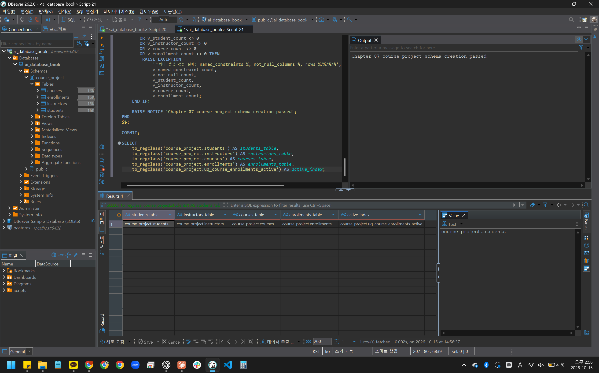
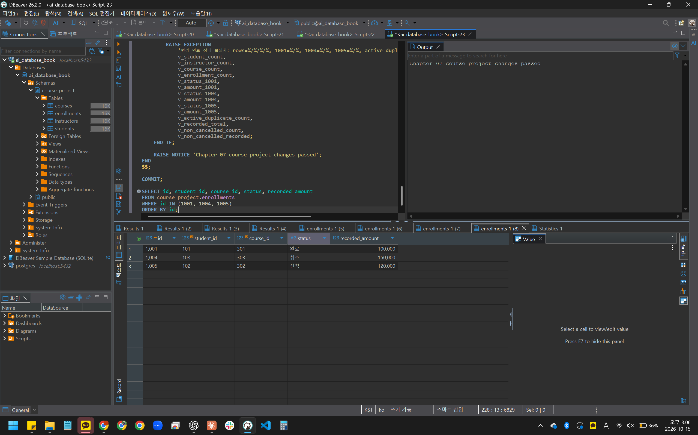
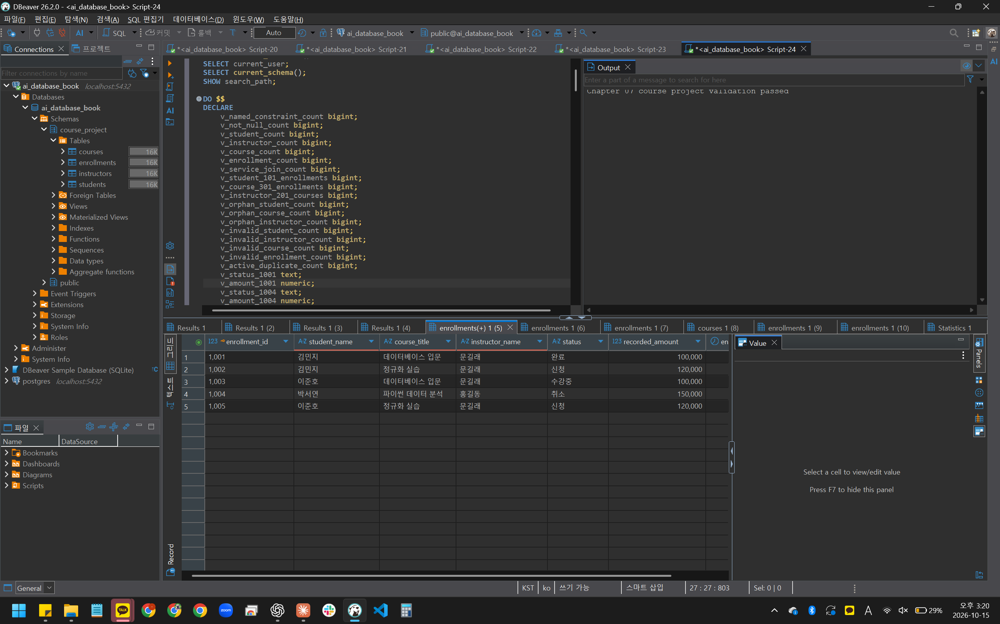
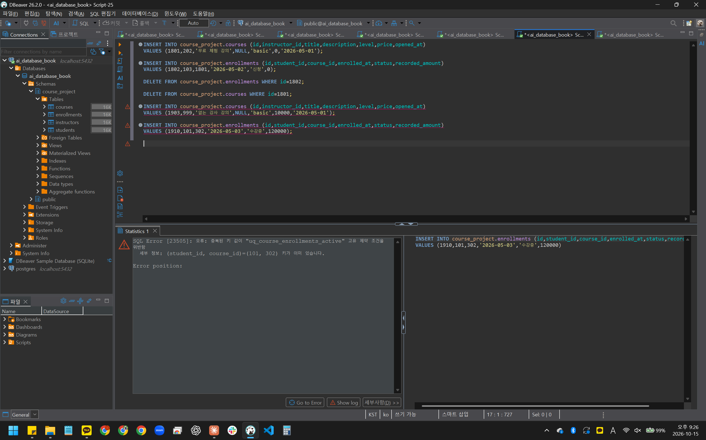
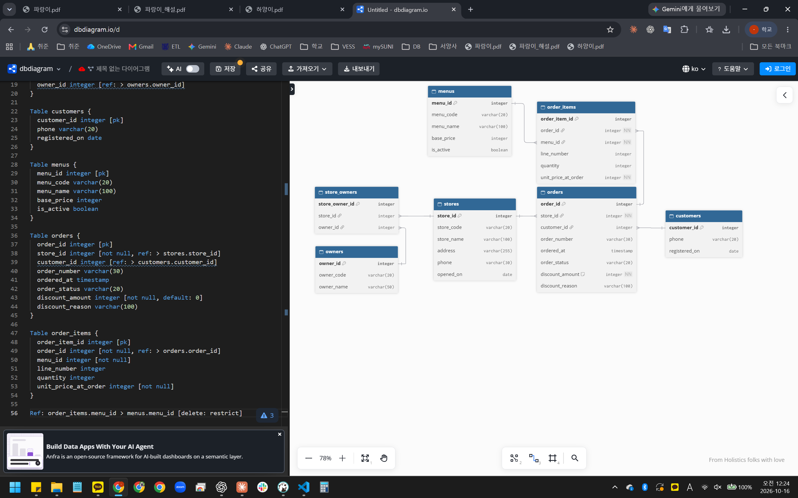

# Chapter 07 확장 실습 답안 템플릿

> **과제:** 실전 프로젝트 1 — 온라인 강의 수강신청 DB 완성하기  
> **사용 방법:** 이 파일을 내려받아 본인의 GitHub 저장소에 `chapter07_answer.md`라는 이름으로 저장한 뒤 실습하면서 바로 작성합니다.  
> **제출 방법:** LMS에는 파일을 직접 업로드하지 않고, **본인 GitHub 저장소의 `chapter07_answer.md` 파일 URL**을 제출합니다.

---

## 제출 전 주의

이 파일과 캡처 화면에는 실제 비밀번호, 전체 DB 접속 URL, API Key, 개인정보를 기록하지 않습니다.

```text
GitHub 계정 또는 별칭: rudah7725
과제 작성일: 2026-10-15
사용한 AI 도구: ChatGPT
```

---

# 1. 시작 환경 확인

다음을 실행합니다.

```sql
SELECT current_database();
SELECT current_user;
SELECT current_schema();
SHOW search_path;
SHOW transaction_read_only;
```

| 확인 항목 | 실제 결과 | 의미 |
| --- | --- | --- |
| `current_database()` | ai_database_book | 실습용 DB에 연결되어 있다 |
| `current_user` | postgres | course_project 스키마를 만들 계정이다. 01부터 05까지 같은 계정으로 실행한다 |
| `current_schema()` | public | 기본 스키마는 public이지만, 프로젝트 SQL은 course_project를 직접 붙여 쓰므로 문제없다 |
| `search_path` | public, "$user" | 이름만 쓰면 public에서 찾는다. 프로젝트 테이블은 항상 course_project.students처럼 쓴다 |
| `transaction_read_only` | off | 읽기 전용이 아니라서 스키마와 테이블을 만들 수 있다 |

- [x] 현재 DB가 `ai_database_book`이다.
- [x] 쓰기 가능한 연결인지 확인했다.
- [x] 실행할 SQL 범위를 확인했다.
- [x] Auto-commit 상태를 확인했다.

### 프로젝트 SQL을 실행하기 전에 시작 상태를 확인해야 하는 이유

```text
이번 프로젝트는 스키마와 테이블을 새로 만들고 데이터를 바꾸기 때문에, 다른 DB나 읽기 전용 연결에서 실행하면 실패하거나 의도하지 않은 곳에 객체가 생길 수 있다. 시작 상태를 먼저 확인해야 실행 결과가 내 의도대로 나왔는지도 판단할 수 있다.
```

---

# 2. 프로젝트 범위와 요구사항 읽기

## 2-1. 포함 범위

본문을 그대로 복사하지 말고 자신의 말로 정리합니다.

```text
1. 학생, 강사, 강의를 각각 독립된 대상으로 관리한다.
2. 학생이 강의에 신청한 사건을 한 건씩 기록한다.
3. 신청마다 현재 진행 상태(신청, 수강중, 완료, 취소)를 함께 둔다.
4. 강의의 현재 가격과, 신청할 때 신청 행에 남긴 금액을 따로 저장한다.
```

## 2-2. 제외 범위

```text
1. 실제 결제가 승인되었는지, 실패했는지, 환불되었는지는 다루지 않는다.
2. 강의 정원과 대기자 관리는 다루지 않는다.
3. 상태가 언제 어떻게 바뀌었는지 전체 이력은 남기지 않는다.
4. 강의 콘텐츠, 진도, 수료, 쿠폰과 할인은 다루지 않는다.
```

### 범위를 명확하게 정해야 하는 이유

```text
범위가 정해지지 않으면 결제나 정원 같은 기능을 하나씩 덧붙이다가 테이블과 규칙이 계속 늘어나서, 지금 배운 범위 안에서 정확하게 만들고 검증하기 어려워진다. 제외 범위를 적어 두면 recorded_amount를 실제 결제액으로 오해하는 것처럼 데이터 의미를 잘못 읽는 것도 막을 수 있다.
```

## 2-3. 요구사항 / 프로젝트 결정 / 미확정 질문 구분

아래 항목 중 대표 항목을 정리합니다.

| ID | 종류 | 내용 요약 | DB 구조/규칙에 미치는 영향 |
| --- | --- | --- | --- |
| P07-R01 | 요구사항 | 학생은 이름, 이메일, 가입일을 가진다 | students 테이블과 필수 열(NOT NULL)이 생긴다 |
| P07-R05 | 요구사항 | 신청은 학생, 강의, 신청일, 상태, 신청 시 기록 금액을 가진다 | enrollments가 학생과 강의를 FK로 참조하고, 사건 속성 열을 가진다 |
| P07-R07 | 요구사항 | 학생과 강사 이메일은 각 테이블 안에서 공백이나 같은 문자열 중복이 안 된다 | 테이블별 UNIQUE와 공백 금지 CHECK가 들어간다 |
| P07-D02 | 프로젝트 결정 | 신청을 만들 때 그 시점의 강의 가격을 recorded_amount에 복사해 둔다 | DB 제약조건이 아니라 신청을 넣는 SQL이 책임지고, 나중에 가격이 바뀌어도 과거 행은 그대로 둔다 |
| P07-D03 | 프로젝트 결정 | 같은 학생이 같은 강의에 진행 중인 신청을 두 건 가질 수 없다 | 상태가 신청이나 수강중인 행에만 걸리는 부분 고유 인덱스가 생긴다 |
| P07-Q01 | 미확정 질문 | 학생과 강사 사이에서도 이메일을 하나도 겹치지 않게 막을 것인가 | 지금은 테이블별 UNIQUE만 두고, 두 테이블에 걸친 제약은 만들지 않는다 |

### 미확정 질문을 바로 제약조건으로 만들면 안 되는 이유

```text
정해지지 않은 규칙을 먼저 걸어 두면 나중에 정책이 다르게 정해졌을 때 정상 데이터가 막히거나 구조를 다시 바꿔야 한다. 예를 들어 학생과 강사 이메일을 전체에서 고유하게 막으면, 강사가 같은 이메일로 수강하는 경우까지 막힐 수 있다.
```

---

# 3. 네 테이블의 한 행 의미와 관계

## 3-1. 한 행 의미

```text
course_project.students 한 행 = 학생 한 명

course_project.instructors 한 행 = 강사 한 명

course_project.courses 한 행 = 강사 한 명이 맡아 개설한 강의 한 개

course_project.enrollments 한 행 = 특정 학생이 특정 강의에 신청한 사건 한 건
```

## 3-2. 키와 중요 규칙

| 테이블 | PK | FK | 중요 규칙 |
| --- | --- | --- | --- |
| students | id | 없음 | 이름, 이메일, 가입일 필수. 이메일 중복 금지, 이름과 이메일 공백 금지 |
| instructors | id | 없음 | 이름, 이메일, 전문 분야 필수. 이메일 중복 금지, 세 값 모두 공백 금지 |
| courses | id | instructor_id → instructors.id (삭제 RESTRICT) | 제목 공백 금지, 난이도는 basic, intermediate, advanced 중 하나, 가격은 0 이상 |
| enrollments | id | student_id → students.id, course_id → courses.id (둘 다 삭제 RESTRICT) | 상태는 신청, 수강중, 완료, 취소 중 하나. recorded_amount는 0 이상. 같은 학생과 강의의 신청, 수강중 행은 하나만 |

## 3-3. 관계를 양방향 문장으로 작성

```text
instructors ↔ courses:
강사 한 명은 강의를 0개 이상 맡을 수 있다. 강의 한 개는 반드시 강사 한 명을 참조한다.

students ↔ enrollments:
학생 한 명은 신청을 0건 이상 가질 수 있다. 신청 한 건은 반드시 학생 한 명을 참조한다.

courses ↔ enrollments:
강의 한 개는 신청을 0건 이상 받을 수 있다. 신청 한 건은 반드시 강의 한 개를 참조한다.
```

### 학생과 강의의 N:M 관계가 `enrollments`를 통해 어떻게 바뀌는지 설명

```text
학생 한 명은 여러 강의를 듣고 강의 한 개도 여러 학생이 들으므로 둘은 N:M이다. 이를 students 1:N enrollments N:1 courses 두 개의 1:N으로 나누고, 신청 한 건이 학생 하나와 강의 하나를 동시에 가리키게 해서 표현한다.
```

### `enrollments`가 단순 연결 테이블이 아니라 사건 테이블이라고 볼 수 있는 이유

```text
학생 ID와 강의 ID만 있는 것이 아니라 신청일, 상태, 신청 당시 기록 금액처럼 그 신청에만 해당하는 값을 가진다. 같은 학생이 같은 강의를 완료하거나 취소한 뒤 다시 신청하면 새 행이 생기므로, 한 행은 관계가 아니라 신청이라는 사건 한 번을 뜻한다.
```

---

# 4. `recorded_amount`의 의미 이해

```text
courses.price = 지금 이 강의에 매겨져 있는 기준 가격

enrollments.recorded_amount = 신청이 만들어질 때 그 신청 행에 남겨 둔 금액
```

### 두 값이 처음에는 같아도 같은 의미가 아닌 이유

```text
지금은 할인 기능이 없어서 신청할 때 price를 그대로 복사하므로 값이 같다. 하지만 나중에 강의 가격이 바뀌면 price만 바뀌고 이미 만들어진 신청의 recorded_amount는 그대로 남는다. 하나는 현재 값이고 하나는 신청 당시 기록이다.
```

### `recorded_amount`를 실제 결제 성공액이나 회계 매출로 해석하면 안 되는 이유

```text
이 프로젝트는 결제 승인, 실패, 환불을 다루지 않는다. recorded_amount는 신청할 때 적어 둔 금액일 뿐이라서 실제로 돈이 들어왔는지, 환불되었는지는 알 수 없다. 취소된 신청도 금액이 그대로 남아 있으므로 그대로 합치면 매출로 볼 수 없다.
```

---

# 5. STEP 01 — 스키마와 테이블 생성

실행 파일:

```text
code/chapter07/01_course_project_schema.sql
```

## 5-1. 실행 전 예상

```text
course_project 스키마 존재 여부: 실행 전 없음, 실행 후 생성됨
예상 테이블 수: 4개 (students, instructors, courses, enrollments)
예상 데이터 행 수: 네 테이블 모두 0행
예상되는 명명 제약조건 수: 15개
예상되는 NOT NULL 열 수: 20개
부분 고유 인덱스 존재 여부: uq_course_enrollments_active 존재
```

## 5-2. 실행 결과

```text
실제 테이블 수: 4개 (students, instructors, courses, enrollments)
실제 명명 제약조건 수: 15개
실제 NOT NULL 열 수: 20개
부분 고유 인덱스: course_project.uq_course_enrollments_active 생성됨
네 테이블의 실제 행 수: 0 / 0 / 0 / 0
통과 메시지: Chapter 07 course project schema creation passed
```

### 예상과 실제 비교

```text
예상한 6가지가 모두 같았다. 01은 이 숫자 중 하나라도 다르면 COMMIT 전에 오류를 내고 전체를 취소하도록 되어 있어서, 통과 메시지가 나왔다는 것 자체가 구조가 완성됐다는 증거가 된다.
```

### 증거 화면

권장 경로:

```text
assignments/chapter07/images/step05_schema.png
```



---

# 6. STEP 02 — Seed 데이터 입력

실행 파일:

```text
code/chapter07/02_course_project_seed.sql
```

## 6-1. 실행 전 예상

```text
students: 3
instructors: 2
courses: 3
enrollments: 4
recorded_amount 합계: 470000 (100000 + 120000 + 100000 + 150000)
학생 101 신청 건수: 2
강의 301 신청 건수: 2
강사 201 담당 강의 수: 2
활성 중복 신청: 0
```

## 6-2. 실제 결과

```text
students: 3
instructors: 2
courses: 3
enrollments: 4
recorded_amount 합계: 470000
학생 101 신청 건수: 2 (1001, 1002)
강의 301 신청 건수: 2 (1001, 1003)
강사 201 담당 강의 수: 2 (301, 302)
활성 중복 신청: 0
1001 상태: 수강중
1004 상태: 신청
1005 존재 여부: 없음
통과 메시지: Chapter 07 course project seed passed
```

### Seed 데이터를 단순 예제가 아니라 검증 데이터라고 볼 수 있는 이유

```text
학생 101은 신청이 2건이라 한 학생이 여러 강의를 신청할 수 있는지, 강의 301은 신청이 2건이라 한 강의에 여러 학생이 신청할 수 있는지 확인할 수 있다. 강사 201은 강의를 2개 맡아 1:N 관계가 실제로 만들어지고, 상태도 신청과 수강중이 섞여 있다. 합계 470000으로 금액도 검산할 수 있어서, 이후 변경과 테스트 결과를 비교하는 기준이 된다.
```

---

# 7. STEP 03 — 변경 시나리오 실행

실행 파일:

```text
code/chapter07/03_course_project_changes.sql
```

## 7-1. 실행 전에 상태 변화를 예상

| 신청 ID | 변경 전 예상 상태 | 변경 후 예상 상태 | 예상 recorded_amount |
| ---: | --- | --- | ---: |
| 1001 | 수강중 | 완료 | 100000 |
| 1004 | 신청 | 취소 | 150000 |
| 1005 | 없음 | 신청 (학생 102, 강의 302 새 신청) | 120000 |

```text
변경 후 예상 enrollments 행 수: 5
변경 후 예상 전체 recorded_amount 합계: 590000 (470000 + 1005의 120000)
변경 후 예상 취소 제외 건수: 4
변경 후 예상 취소 제외 recorded_amount 합계: 440000 (590000 - 1004의 150000)
```

## 7-2. 실제 결과

```text
1001 상태 / recorded_amount: 완료 / 100000
1004 상태 / recorded_amount: 취소 / 150000
1005 상태 / recorded_amount: 신청 / 120000
최종 enrollments 행 수: 5
전체 recorded_amount 합계: 590000
취소 제외 건수: 4
취소 제외 recorded_amount 합계: 440000
활성 중복 신청: 0
통과 메시지: Chapter 07 course project changes passed
```

### 조건부 UPDATE에서 예상 이전 상태를 확인해야 하는 이유

```text
WHERE id = 1001만 쓰면 그 사이 다른 작업으로 이미 취소된 신청도 완료로 덮어쓸 수 있다. AND status = '수강중'을 함께 걸어 두면 내가 예상한 상태일 때만 바뀌고, 상태가 다르면 아무 행도 바뀌지 않아서 잘못된 변경을 막을 수 있다. 03은 시작 상태가 다르면 아예 실행을 멈추도록 먼저 검사한다.
```

### 증거 화면

권장 경로:

```text
assignments/chapter07/images/step07_changes.png
```



---

# 8. STEP 04 — 최종 완료 게이트 실행

실행 파일:

```text
code/chapter07/04_course_project_validation.sql
```

## 8-1. 최종 검증 결과

```text
최종 행 수 students/instructors/courses/enrollments: 3 / 2 / 3 / 5
서비스 JOIN 결과 행 수: 5
학생 101 신청 수: 2 (1001, 1002)
강의 301 신청 수: 2 (1001, 1003)
강사 201 강의 수: 2 (301, 302)
고아 관계 수: 0 (학생 0, 강의 0, 강사 0)
활성 중복 신청 수: 0
전체 recorded_amount: 590000
취소 제외 recorded_amount: 440000
통과 메시지: Chapter 07 course project validation passed
```

### SQL 파일 4개가 모두 실행되었다는 사실과 프로젝트 검증 PASS가 다른 이유

```text
파일이 오류 없이 실행됐다는 것은 문법이 맞았다는 뜻일 뿐, 결과 데이터가 요구사항을 만족한다는 뜻은 아니다. 예를 들어 03의 UPDATE가 조건이 안 맞아 0행만 바뀌어도 SQL 자체는 성공한다. 04는 제약조건 수, 행 수, 관계, 금액 합계까지 기대값과 하나하나 비교하므로, PASS가 나와야 프로젝트가 의도한 상태라고 말할 수 있다.
```

### 증거 화면

권장 경로:

```text
assignments/chapter07/images/step08_validation.png
```



---

# 9. 무결성 테스트

실행 파일:

```text
code/chapter07/05_course_project_integrity_tests.sql
```

> 오류 테스트는 파일 전체를 무작정 실행하지 않고 **한 테스트 구간씩** 실행합니다.

## 9-1. 허용되어야 하는 경계값 1개

```text
테스트 내용: 가격 0원에 설명이 NULL인 무료 강의 1801을 추가하고, 그 강의에 금액 0원 신청 1802를 추가한 뒤 둘 다 삭제
기대 결과: 성공
실제 결과: 성공. INSERT 2개와 DELETE 2개 모두 Updated Rows 1
왜 허용되어야 하는가: 무료 강의는 가격이 0원인 확정 금액이고(P07-D01), 설명은 선택 항목이다. 가격과 기록 금액 규칙은 음수만 막는 것이라 0은 통과해야 한다.
```

## 9-2. 실패해야 하는 테스트 1 — 잘못된 참조 또는 값

```text
테스트 내용: 존재하지 않는 강사 999를 참조하는 강의 1903 추가
기대 결과: FK 위반으로 실패
실제 오류 핵심: SQL Error [23503] insert or update on table courses violates foreign key constraint fk_course_courses_instructor, Key (instructor_id)=(999) is not present in table instructors
동작한 제약조건/규칙: fk_course_courses_instructor (P07-R04, R09)
왜 실패해야 하는가: 강의는 반드시 실제로 있는 강사 한 명을 참조해야 한다. 없는 강사를 가리키는 강의가 들어가면 누가 맡은 강의인지 알 수 없다.
```

## 9-3. 실패해야 하는 테스트 2 — 활성 중복 신청

```text
테스트 내용: 학생 101이 강의 302에 이미 신청 상태인 1002가 있는데, 같은 조합으로 수강중 신청 1910을 추가
기대 결과: 부분 고유 인덱스 위반으로 실패
실제 오류 핵심: SQL Error [23505] 중복된 키 값이 uq_course_enrollments_active 고유 제약 조건을 위반함, (student_id, course_id)=(101, 302) 키가 이미 있습니다
동작한 인덱스/규칙: uq_course_enrollments_active (P07-D03)
왜 실패해야 하는가: 같은 학생이 같은 강의에 진행 중인 신청을 두 건 가지면 어느 신청이 유효한지 알 수 없다. 완료나 취소된 이력은 이 인덱스에 걸리지 않아 다시 신청할 수 있다.
```

## 9-4. 실패 후 기준 상태 재검증

```text
04 validation 재실행 결과: 두 실패 테스트를 모두 실행한 뒤 다시 실행했고 Chapter 07 course project validation passed가 나왔다.
기준 데이터가 유지되었는가: 유지됨. 05의 기준 확인 블록에서도 Chapter 07 core integrity test baseline preserved가 나왔고, 마지막 04 재실행에서 3/2/3/5행, 590000, 440000, 고아 관계 0 등 기준을 모두 통과했다.
```

### 실패 테스트가 프로젝트 품질 검증에 필요한 이유

```text
정상 데이터가 잘 들어가는 것만으로는 규칙이 제대로 걸려 있는지 알 수 없다. 없는 강사 참조나 중복 신청처럼 막혀야 할 값을 일부러 넣어 보고, 실제로 막힌 뒤에도 기준 데이터가 그대로인지 확인해야 프로젝트 규칙이 실제로 작동한다고 말할 수 있다.
```

### 증거 화면

권장 경로:

```text
assignments/chapter07/images/step09_integrity.png
```



---

# 10. 재현성 실험

> 이 단계는 본인의 실습 환경이며 보존할 데이터가 없을 때만 수행합니다.

실행 순서:

```text
reset_course_project.sql
→ 01_course_project_schema.sql
→ 02_course_project_seed.sql
→ 03_course_project_changes.sql
→ 04_course_project_validation.sql
```

```text
처음 실행의 최종 결과: 04 validation passed, 행 수 3/2/3/5, 전체 기록 금액 590000, 취소 제외 4건 440000, 고아 행 0
재실행의 최종 결과: reset passed 후 01~04를 순서대로 다시 실행해 모두 passed, 04 결과 3/2/3/5, 590000, 4건 440000, 고아 행 0
두 결과가 일치했는가: 예. 행 수와 금액이 같았고 04가 1001 완료, 1004 취소, 1005 신청 상태까지 확인한 뒤 통과했다
중간에 수동 수정이 필요했는가: 아니오. 파일 내용은 고치지 않고 순서대로 실행만 했다
```

### 다른 사람이 같은 순서로 실행해 같은 결과를 얻는 것이 중요한 이유

```text
결과가 실행하는 사람이나 중간에 손으로 고친 내용에 따라 달라지면, 문제가 생겼을 때 설계가 잘못된 건지 실행 과정이 잘못된 건지 구분하기 어렵다. 파일과 실행 순서만으로 같은 상태가 나와야 다른 사람도 같은 기준에서 결과를 확인하고 비교할 수 있다. 이번에도 01, 02, 03은 이미 실행된 상태에서 다시 돌리면 오류로 멈추게 되어 있어서, 순서가 꼬였을 때 잘못된 데이터가 섞인 채로 넘어가지 않았다.
```

---

# 11. Chapter 01~06 개인 프로젝트를 중간 프로젝트 초안으로 확장

온라인 강의 예제를 이름만 바꾸지 않고 본인의 아이디어를 사용합니다.

## 11-1. 프로젝트 기본 정보

```text
프로젝트 이름: 외식업 가맹점 운영 관리 서비스

해결하려는 문제: 가맹점, 메뉴, 주문 정보가 따로 관리되면 가맹점별 주문 현황과 매출을 확인하기 어렵고, 메뉴 가격이 바뀌거나 판매가 중지될 때 과거 주문 기록이 흔들릴 수 있다. 이를 한 데이터베이스에서 관리해 주문 기록을 근거로 운영 상황을 확인할 수 있게 한다. 또 고객과 할인 정보가 없으면 어떤 고객이 다시 오는지, 할인 때문에 실제 매출이 얼마나 줄었는지 알 수 없다.

주요 사용자: 프랜차이즈 본사 운영 담당자, 가맹점주
```

## 11-2. 포함 범위 / 제외 범위

```text
[포함]
1. 가맹점 기본 정보와 가맹점주 정보 관리
2. 본사 메뉴와 판매 여부 관리
3. 가맹점에서 발생한 주문과 주문 항목, 주문 당시 단가 기록
4. 주문 기록을 이용한 가맹점별 주문 합계 계산
5. 고객 정보와 주문한 고객 기록
6. 주문별 할인 금액과 할인 이유 기록

[제외]
1. 결제 처리와 환불 (매출 기준이 정해지지 않음)
2. 재고와 원재료 관리
3. 직원과 근무 일정 관리
4. 본사와 가맹점주의 로그인 및 권한 구분
5. 쿠폰과 포인트 적립 시스템 (발표 피드백에 따라 1차 범위에서 제외)
```

## 11-3. 요구사항

최소 8개를 작성합니다.

| ID | 요구사항 | 관련 테이블/관계 | 검증 방법 후보 |
| --- | --- | --- | --- |
| P07-MR01 | 가맹점은 가맹점 코드, 가맹점명, 주소, 전화번호, 개점일을 가진다 | stores | 가상 가맹점 2곳을 넣고 행 수와 필수값 NULL 여부 확인 |
| P07-MR02 | 가맹점주는 점주 코드와 이름을 가진다 | owners, store_owners (P07-MQ01 허용 시) | 점주를 넣고 조회, 가맹점 연결 방식은 MQ01이 정해진 뒤 확인 |
| P07-MR03 | 메뉴는 메뉴 코드, 메뉴명, 기본 가격, 판매 여부를 가진다 | menus | 가상 메뉴 2개를 넣고 조회 |
| P07-MR04 | 주문은 존재하는 가맹점에서만 발생한다 | stores 1:N orders | 없는 store_id로 주문을 넣는 실패 테스트 |
| P07-MR05 | 주문 항목은 존재하는 주문과 메뉴를 가리킨다 | orders 1:N order_items, menus 1:N order_items | 없는 order_id, menu_id로 넣는 실패 테스트 |
| P07-MR06 | 같은 메뉴는 여러 주문에서 반복해 주문될 수 있다 | orders N:M menus (order_items로 해소) | 같은 menu_id를 서로 다른 두 주문에 넣어 성공 확인 |
| P07-MR07 | 주문 항목에는 주문 당시 단가를 저장하고, 메뉴 기본 가격이 바뀌어도 그대로 유지한다 | order_items.unit_price_at_order | base_price를 바꾼 뒤 기존 주문 항목의 단가가 그대로인지 비교 |
| P07-MR08 | 판매 중지된 메뉴도 과거 주문 기록에서 계속 확인할 수 있다 | menus.is_active, order_items.menu_id FK | 주문된 메뉴 삭제 실패 테스트, is_active를 false로 바꾼 뒤 JOIN 조회 |
| P07-MR09 | 가맹점별 합계는 따로 저장하지 않고 주문 기록으로 계산한다 | orders, order_items | 수량과 주문 당시 단가로 계산한 합계를 손 계산값과 비교 (포함 기준은 MQ02) |
| P07-MR10 | 고객은 고객 번호(customer_id)와 연락처를 가진다 | customers | 가상 고객 2명을 넣고 조회 (registered_on을 포함한 수집 항목은 MQ06) |
| P07-MR11 | 주문에는 주문한 고객을 기록할 수 있다 | customers 1:N orders | 고객이 있는 주문을 넣어 조회, 없는 customer_id로 넣는 실패 테스트 |
| P07-MR12 | 주문마다 할인 금액과 할인 이유를 기록하고, 판매 금액과 실제 판매 금액을 구분해서 계산한다 | orders.discount_amount, discount_reason, order_items | 판매 금액, 할인 금액, 실제 판매 금액을 손 계산값과 비교 |

## 11-4. 프로젝트 결정

최소 3개를 작성합니다.

| ID | 이번 프로젝트에서 내린 결정 | 이유 | 구현 후보 |
| --- | --- | --- | --- |
| P07-MD01 | 주문 당시 단가를 order_items에 따로 저장한다 | 메뉴 가격이 바뀌어도 과거 주문 금액이 바뀌면 안 된다 | unit_price_at_order NOT NULL |
| P07-MD02 | 주문된 메뉴는 삭제하지 않고 is_active로 판매 중지만 표시한다 | 과거 주문 기록이 가리키는 메뉴가 사라지지 않게 한다 | menus.is_active, FK ON DELETE RESTRICT |
| P07-MD03 | 주문과 주문 항목은 부모 없이 만들 수 없다 | 가맹점 없는 주문이나 메뉴 없는 주문 항목은 의미가 없다 | orders.store_id, order_items.order_id, menu_id NOT NULL + FK |
| P07-MD04 | 매출 합계는 별도 테이블에 저장하지 않는다 | 합계를 따로 저장하면 주문 기록과 값이 어긋날 수 있다 | 집계 조회와 검증 SQL |
| P07-MD05 | 할인 금액은 주문마다 저장하고, 실제 판매 금액은 저장하지 않고 판매 금액에서 할인 금액을 빼서 계산한다 | MD04처럼 계산값을 따로 저장하면 주문 기록과 어긋날 수 있고, 할인이 없는 주문도 합계가 깨지지 않아야 한다 | orders.discount_amount NOT NULL DEFAULT 0, discount_reason |

## 11-5. 미확정 질문

최소 3개를 작성합니다.

```text
P07-MQ01. 한 가맹점을 여러 점주가 함께 운영하거나, 한 점주가 여러 가맹점을 운영할 수 있는가?
P07-MQ02. 매출에 포함하는 주문은 무엇이고, 취소와 환불은 어떻게 반영하며, 기간은 주문일과 결제일 중 무엇으로 나누는가?
P07-MQ03. 판매 중지된 메뉴를 새 주문에서 선택하지 못하게 막을 것인가?
P07-MQ04. 주문과 주문 항목을 삭제할 수 있는가?
P07-MQ05. 메뉴 코드와 점주 코드의 중복 금지 범위, 수량과 가격의 허용 범위를 어떻게 정할 것인가?
P07-MQ06. 고객 정보로 무엇을 수집하는가 (전화번호, 성별 등)? 수집 동의는 어떻게 받고, 가맹점끼리 고객 정보를 공유하는가?
P07-MQ07. 고객 정보 없이 주문하는 비회원 주문을 허용하는가?
P07-MQ08. 메뉴 옵션 (예: 대, 중, 소와 옵션별 추가 금액)을 어떻게 설계하는가? 교수님 피드백 문서를 받은 뒤 정한다.
P07-MQ09. 할인 종류를 미리 정해 둘 것인가, 할인 금액은 판매 금액을 넘을 수 없게 막을 것인가?
```

---

# 12. 개인 프로젝트 ERD와 한 행 의미

## 12-1. 테이블 후보

최소 4개를 권장합니다.

| 테이블 | 한 행의 의미 | PK 후보 | FK 후보 | 주요 규칙 |
| --- | --- | --- | --- | --- |
| stores | 가맹점 한 곳의 기본 정보 (대상) | store_id | 없음 | store_code의 변경과 재사용은 미확정 |
| owners | 가맹점주 한 명 (대상) | owner_id | 없음 | owner_code 중복 금지 범위는 미확정 (MQ05) |
| store_owners | 점주 한 명과 가맹점 한 곳의 운영 관계 (연결, MQ01을 허용할 때의 안) | store_owner_id | store_id → stores, owner_id → owners | MQ01이 정해지기 전까지 후보로 둔다 |
| customers | 고객 한 명 (대상) | customer_id | 없음 | registered_on을 포함한 수집 항목과 가맹점 간 공유 여부는 미확정 (MQ06) |
| menus | 본사에서 관리하는 메뉴 한 개 (대상) | menu_id | 없음 | 주문된 메뉴는 삭제하지 않고 is_active로 판매 중지만 표시 (MD02) |
| orders | 특정 가맹점에서 발생한 주문 한 건 (사건) | order_id | store_id → stores, NOT NULL / customer_id → customers | 가맹점 없는 주문 금지 (MD03), 비회원 주문 여부가 미정이라 customer_id는 NULL 허용 (MQ07), 할인 금액 기본값 0 (MD05), order_number 고유 범위는 미확정 |
| order_items | 한 주문에 포함된 주문 상세 한 줄 (사건) | order_item_id | order_id → orders, menu_id → menus, 둘 다 NOT NULL | 주문 당시 단가 NOT NULL (MD01), 메뉴 삭제 RESTRICT, 수량과 가격 범위는 미확정 (MQ05) |

## 12-2. 관계 문장

```text
1. 가맹점 한 곳은 주문을 여러 건 가질 수 있고 아직 주문이 없을 수도 있다. 주문 한 건은 반드시 가맹점 한 곳에서 발생한다.
2. 주문 한 건은 주문 항목을 여러 줄 가질 수 있다. 주문 항목 한 줄은 반드시 주문 한 건에 속한다.
3. 메뉴 한 개는 여러 주문 항목에서 참조될 수 있고 아직 주문되지 않은 메뉴는 0건이다. 주문 항목 한 줄은 반드시 메뉴 한 개를 가리키며, 주문된 메뉴는 삭제할 수 없다.
4. 가맹점과 점주의 관계는 P07-MQ01에 따라 정한다. 공동 운영과 여러 매장 운영을 모두 허용하면 store_owners로 N:M을 푼다.
5. 고객 한 명은 주문을 여러 건 할 수 있다. 주문 한 건은 고객 한 명과 연결되며, 비회원 주문을 허용하면 고객 없이 기록될 수도 있다 (MQ07).
```

## 12-3. ERD

권장 이미지 경로:

```text
assignments/chapter07/images/personal_project_erd.png
```



### Chapter 05~06 ERD에서 이번에 바꾼 점

```text
P07-MD01에 맞춰 order_items.unit_price_at_order에 NOT NULL을 추가했다. 또 10월 10일 프로젝트 발표에서 고객 정보가 없고 할인 금액이 구분되지 않는다는 교수님 피드백을 받아 customers 테이블과 orders.customer_id, discount_amount, discount_reason을 추가했다. 메뉴 옵션도 지적받았지만 설계가 복잡해 피드백 문서를 받은 뒤 정하기로 하고 MQ08로 남겼다. store_owners는 MQ01이 정해지지 않아 Chapter 05~06처럼 후보로 남겼다.
```

---

# 13. 개인 프로젝트 완료 기준 만들기

“잘 동작한다”처럼 모호하게 쓰지 말고 검증 가능한 기준을 최소 6개 작성합니다.

| 번호 | 완료 기준 | 자동 SQL 검증 가능? | 검증 방법 |
| ---: | --- | --- | --- |
| 1 | Ch05 시나리오 seed 실행 후 stores, owners, store_owners, menus, orders, order_items의 행 수가 각각 2/1/2/2/3/4다 (store_owners 2행은 MQ01을 허용한다고 가정한 시나리오) | 예 | 테이블별 COUNT를 검증 SQL에서 비교 |
| 2 | 없는 가맹점, 주문, 메뉴, 고객을 가리키는 행은 0건이고, 그런 행을 넣으면 DB가 거부한다 | 예 | LEFT JOIN 고아 행 조회 0건, 없는 store_id와 customer_id로 넣는 실패 테스트 (23503), 필수 FK에 NULL을 넣는 실패 테스트 (23502) |
| 3 | 불고기버거 기본 가격을 6,500원으로 바꾼 뒤에도 주문 1번과 2번의 주문 당시 단가는 6,000원이다 | 예 | 가격 UPDATE 전후로 unit_price_at_order 조회 비교 |
| 4 | 주문된 메뉴(콜라)를 삭제하면 DB가 거부하고, 판매 중지로 바꾼 뒤에도 주문 1번 조회에 콜라가 나온다 | 예 | DELETE 실패 테스트 (23503), is_active를 false로 바꾼 뒤 JOIN 조회 |
| 5 | Ch05 시나리오 주문 1~3번의 할인 전 판매 금액 합계가 손 계산값 26,500원 (14,000 + 6,000 + 6,500)과 같다 | 예 | 현재 base_price가 아닌 주문 당시 단가로 수량 곱하기 단가의 SUM을 계산해 비교 |
| 6 | 할인 금액을 생략한 주문은 0으로 저장되고 명시적 NULL은 거부된다. 항목이 두 줄인 주문에 할인을 넣어도 실제 판매 금액은 판매 금액에서 할인 금액을 한 번만 뺀 값이다 | 예 | 생략과 NULL 입력 테스트 (23502), 주문별 판매 금액을 먼저 구한 뒤 할인을 빼는 집계와 JOIN 후 바로 합산한 값 비교 |
| 7 | 요구사항 MR01~MR12가 모두 ERD의 테이블이나 열 하나 이상과 연결된다 | 아니오 (사람 검토) | 11-3 표와 ERD를 한 줄씩 대조 |
| 8 | 미확정 질문 MQ01~MQ09에 해당하는 규칙은 제약조건으로 넣지 않았다 | 아니오 (사람 검토) | 제약조건 목록과 MQ를 대조 |
| 9 | 가상 고객을 주문에 연결하면 JOIN으로 그 주문의 고객이 정확히 조회된다 | 예 | customers와 orders JOIN 조회 |

예시 형식:

```text
Seed 실행 후 A/B/C/D 테이블의 행 수가 각각 5/3/8/12다.
존재하지 않는 부모를 참조하는 행은 0건이다.
허용되지 않은 상태 입력은 DB가 거부한다.
검증 SQL이 예상 결과를 반환한다.
```

---

# 14. AI를 프로젝트 리뷰어로 사용

AI에게 프로젝트를 대신 완성시키지 않고 누락과 위험을 찾게 합니다.

## 14-1. AI에게 전달한 핵심 자료

```text
요구사항: 11-3의 P07-MR01~MR12

테이블/ERD 설명: 12-1의 7개 테이블과 한 행의 의미, 12-2 관계 문장 5개, 12-3 ERD의 열 구성

프로젝트 결정: 11-4의 P07-MD01~MD05

미확정 질문: 11-5의 P07-MQ01~MQ09

완료 기준: 13번의 8개 기준
```

## 14-2. 내가 사용한 프롬프트

```text
데이터베이스 수업에서 중간 프로젝트 초안을 만들고 있어. 외식업 가맹점 운영 관리 서비스인데, 대신 설계하거나 완성하지 말고 누락과 위험만 찾아 줘.
1. 요구사항 중에 아래 테이블이나 열과 연결되지 않는 게 있는지 봐 줘.
2. 각 테이블 한 행의 의미가 열 구성과 맞는지 봐 줘.
3. 내가 미확정으로 둔 정책은 확정하지 말고, 필요하면 확인 질문으로만 남겨 줘.
4. 완료 기준 중에 모호하거나 SQL로 확인하기 어려운 게 있는지, 빠진 실패 테스트가 있는지 알려 줘.
5. 제약조건만으로 막기 어려운 규칙을 제안한다면 어떤 기능이 필요한지 같이 적어 줘.

요구사항:
MR01 가맹점은 가맹점 코드, 가맹점명, 주소, 전화번호, 개점일을 가진다
MR02 가맹점주는 점주 코드와 이름을 가진다
MR03 메뉴는 메뉴 코드, 메뉴명, 기본 가격, 판매 여부를 가진다
MR04 주문은 존재하는 가맹점에서만 발생한다
MR05 주문 항목은 존재하는 주문과 메뉴를 가리킨다
MR06 같은 메뉴는 여러 주문에서 반복해 주문될 수 있다
MR07 주문 항목에는 주문 당시 단가를 저장하고, 메뉴 기본 가격이 바뀌어도 그대로 유지한다
MR08 판매 중지된 메뉴도 과거 주문 기록에서 계속 확인할 수 있다
MR09 가맹점별 합계는 따로 저장하지 않고 주문 기록으로 계산한다
MR10 고객은 고객 번호와 연락처를 가진다
MR11 주문에는 주문한 고객을 기록할 수 있다
MR12 주문마다 할인 금액과 할인 이유를 기록하고, 판매 금액과 실제 판매 금액을 구분해서 계산한다

테이블 (한 행의 의미: 열):
stores 가맹점 한 곳: store_id PK, store_code, store_name, address, phone, opened_on
owners 가맹점주 한 명: owner_id PK, owner_code, owner_name
store_owners 점주 한 명과 가맹점 한 곳의 운영 관계, 공동 운영을 허용할 때의 안: store_owner_id PK, store_id FK, owner_id FK
customers 고객 한 명: customer_id PK, phone, registered_on
menus 메뉴 한 개: menu_id PK, menu_code, menu_name, base_price, is_active
orders 주문 한 건: order_id PK, store_id FK NOT NULL, customer_id FK (NULL 허용), order_number, ordered_at, order_status, discount_amount NOT NULL DEFAULT 0, discount_reason
order_items 주문 상세 한 줄: order_item_id PK, order_id FK NOT NULL, menu_id FK NOT NULL ON DELETE RESTRICT, line_number, quantity, unit_price_at_order NOT NULL

결정:
MD01 주문 당시 단가를 order_items에 따로 저장한다
MD02 주문된 메뉴는 삭제하지 않고 is_active로 판매 중지만 표시한다
MD03 주문과 주문 항목은 부모 없이 만들 수 없다
MD04 매출 합계는 별도 테이블에 저장하지 않는다
MD05 실제 판매 금액은 저장하지 않고 판매 금액에서 할인 금액을 빼서 계산한다

미확정:
MQ01 공동 운영이나 여러 매장 운영을 허용하나
MQ02 매출에 넣는 주문, 취소와 환불 반영, 매출 기간 기준
MQ03 판매 중지 메뉴를 새 주문에서 막을지
MQ04 주문과 주문 항목을 삭제할 수 있나
MQ05 코드 중복 금지 범위, 수량과 가격 범위
MQ06 고객 정보 수집 항목, 동의, 가맹점 간 공유
MQ07 비회원 주문 허용 여부
MQ08 메뉴 옵션 설계
MQ09 할인 종류, 할인 금액이 판매 금액을 넘지 못하게 막을지

완료 기준:
1 seed 후 stores, owners, store_owners, menus, orders, order_items 행 수 2/1/2/2/3/4
2 없는 부모를 가리키는 행 0건, 넣으면 거부
3 메뉴 가격을 바꿔도 기존 주문 단가 유지
4 주문된 메뉴 삭제 거부, 판매 중지 후에도 과거 주문 조회 가능
5 강남점 판매 금액 합계가 손 계산값 26500원과 같음
6 할인 없는 주문의 할인 금액 0, 실제 판매 금액 = 판매 금액 - 할인 금액
7 요구사항이 모두 ERD와 연결됨 (사람 검토)
8 미확정 규칙은 제약조건으로 넣지 않음 (사람 검토)
```

## 14-3. AI 제안 검토

| AI 제안 | 수용 / 수정 / 보류 / 거절 | 실제 근거 | 반영 내용 |
| --- | --- | --- | --- |
| 기준 1의 store_owners 2행은 MQ01을 허용한다고 가정한 시나리오라고 표시해야 한다 | 수용 | Ch05 16번 시나리오에서도 Q01 허용을 가정한 예시였는데, 13번에 옮기면서 그 표시가 빠졌다 | 기준 1에 가정을 적었다 |
| 기준 5의 26,500원은 계산 근거가 없고, MQ02가 미정이라 매출이라고 부르면 안 된다 | 수용 | 프롬프트에 수량과 단가를 넣지 않았고, 매출 기준은 아직 정하지 않았다 | 기준 5를 주문 1~3번의 할인 전 판매 금액 합계로 바꾸고 계산식을 적었다 |
| 항목이 두 줄인 주문을 JOIN해서 합산하면 주문 할인이 두 번 빠질 수 있다 | 수용 | 할인은 orders에, 항목은 order_items에 있어 JOIN하면 주문 행이 항목 수만큼 반복된다. 이번 Chapter에서 JOIN 중복을 확인한 것과 같은 문제다 | 기준 6에 할인이 한 번만 빠지는지 확인하는 테스트를 넣었다 |
| 고객 요구사항 MR10, MR11에 맞는 완료 기준이 없다 | 수용 | 고객을 추가하면서 13번에는 고객 기준을 넣지 않았다 | 기준 9를 추가했다 |
| MR10의 고객 번호가 customer_id인지 밝히고, registered_on은 요구사항에 없으니 근거를 대거나 확인 대상으로 남겨야 한다 | 수정 | 고객 번호는 customer_id를 뜻했다. registered_on은 요구사항 없이 넣은 열이다 | MR10에 customer_id를 밝히고, registered_on은 열을 빼지 않고 MQ06 수집 항목 확인 대상으로 표시했다 |
| 필수 FK에 NULL을 넣는 경우와 discount_amount를 생략하거나 NULL로 넣는 경우도 테스트해야 한다 | 수용 | NOT NULL과 DEFAULT 0이 따로 동작하는지는 실제로 넣어 봐야 알 수 있다 | 기준 2와 6의 검증 방법에 추가했다 |
| 주문 당시 단가가 바뀌지 않게 하려면 트리거를 검토할 수 있다 | 보류 | 아직 배우지 않은 기능이고, 잘못 입력한 단가를 고치는 걸 허용할지도 정하지 않았다 | 반영하지 않았다 |
| 주문 항목을 먼저 지우면 RESTRICT로는 메뉴 기록을 보호할 수 없다 | 보류 | 주문과 주문 항목의 삭제 정책(MQ04)이 정해져야 판단할 수 있다. Ch06 리뷰에서도 같은 지적을 받았다 | 반영하지 않았다 |

### AI가 미확정 정책을 임의로 확정하려 한 부분이 있었나요?

```text
없었다. 오히려 기준 1의 store_owners 2행과 customer_id NULL 허용이 MQ01, MQ07을 확정한 것처럼 읽힐 수 있다고 짚었다. 수량 0, 할인 상한, 판매 중지 메뉴의 새 주문은 MQ03, MQ05, MQ09가 미정이라 지금 실패 테스트로 정하면 안 된다고도 했다.
```

### AI가 제안한 규칙 중 아직 배우지 않은 기능이라 보류한 것이 있나요?

```text
주문 당시 단가 변경 방지, 할인 상한, 판매 중지 메뉴 주문 차단에 트리거나 트랜잭션 안의 검증을 검토하라는 제안이다. 트리거는 아직 배우지 않았고, 이 규칙들은 정책도 정해지지 않아서 보류했다.
```

### AI 활용 후 실제로 좋아진 부분

```text
주문 할인이 JOIN 때문에 두 번 빠질 수 있다는 걸 놓치고 있었는데, 기준 6에 그걸 확인하는 테스트를 넣었다. 26,500원을 매출이라고 부르던 걸 할인 전 판매 금액 합계로 범위를 줄였고, 고객을 추가하고도 완료 기준을 안 만든 것도 찾아서 기준 9를 넣었다.
```

---

# 15. 최종 성찰

아래 문장은 반드시 본인의 말로 작성합니다.

```text
1. 데이터베이스 프로젝트가 완료되었다고 판단하려면
   SQL 파일의 존재보다 처음부터 다시 실행해도 같은 결과가 나오는 재현성과, 그 결과를 숫자로 확인하는 검증이 중요하다.

2. Seed 데이터의 목적은 단순히 화면을 채우는 것이 아니라
   이후 변경과 검증이 비교할 기준 상태를 만드는 것이다.

3. 실패 테스트가 필요한 이유는
   잘못된 데이터를 DB가 실제로 막는지, 그리고 막은 뒤에도 기존 데이터가 그대로인지 직접 확인하기 위해서이다.

4. 요구사항과 프로젝트 결정을 구분해야 하는 이유는
   요구사항은 서비스가 해야 하는 일이고 결정은 그걸 어떻게 구현할지 내가 고른 것이라, 섞어 쓰면 아직 정하지 않은 정책까지 확정된 것처럼 보이기 때문이다.

5. 내가 만든 개인 프로젝트에서 가장 먼저 추가 확인해야 할 정책은
   고객 정보로 무엇을 수집하고 가맹점끼리 공유할지(P07-MQ06)이다. 발표에서 가장 크게 지적받은 부분이고, 이게 정해져야 customers의 열과 비회원 주문 허용 여부(MQ07)도 정할 수 있다.
```

---

# 16. 제출 체크리스트

- [x] `chapter07_answer.md`를 본인 저장소에 만들었다.
- [x] 시작 환경과 현재 DB를 확인했다.
- [x] 프로젝트 포함/제외 범위를 설명했다.
- [x] 요구사항/결정/미확정 질문을 구분했다.
- [x] 네 테이블의 한 행 의미와 관계를 설명했다.
- [x] `01_course_project_schema.sql`을 실행하고 결과를 확인했다.
- [x] `02_course_project_seed.sql`의 기준 상태를 확인했다.
- [x] `03_course_project_changes.sql` 전후 상태를 비교했다.
- [x] `04_course_project_validation.sql` PASS를 확인했다.
- [x] 허용 경계값 1개 이상을 확인했다.
- [x] 실패 테스트 2개 이상을 한 구간씩 실행했다.
- [x] 실패 후 validation을 다시 실행했다.
- [x] 개인 프로젝트 요구사항 8개 이상을 작성했다.
- [x] 프로젝트 결정 3개 이상과 미확정 질문 3개 이상을 작성했다.
- [x] 개인 프로젝트 ERD를 작성했다.
- [x] 검증 가능한 완료 기준 6개 이상을 작성했다.
- [x] AI 제안을 수용/수정/보류/거절로 구분했다.
- [x] 핵심 캡처는 3~4장 정도로 정리했다.
- [x] 캡처에 비밀번호나 개인정보가 없다.
- [x] GitHub 웹에서 Markdown과 이미지가 정상적으로 보인다.
- [x] 최종 파일을 commit/push했다.

---

# 17. LMS 제출 URL

아래 형식의 **본인 GitHub 파일 URL**을 LMS에 제출합니다.

```text
https://github.com/<본인-GitHub-ID>/<본인-저장소>/blob/main/assignments/chapter07/chapter07_answer.md
```

내 제출 URL:

```text
https://github.com/rudah7725/database-course-2026-2/blob/main/assignments/chapter07/chapter07_answer.md
```

> 저장소 메인 URL, 교수자 템플릿 URL, Raw URL이 아니라 **작성 완료된 본인 `chapter07_answer.md` 파일 화면 URL**을 제출합니다.
