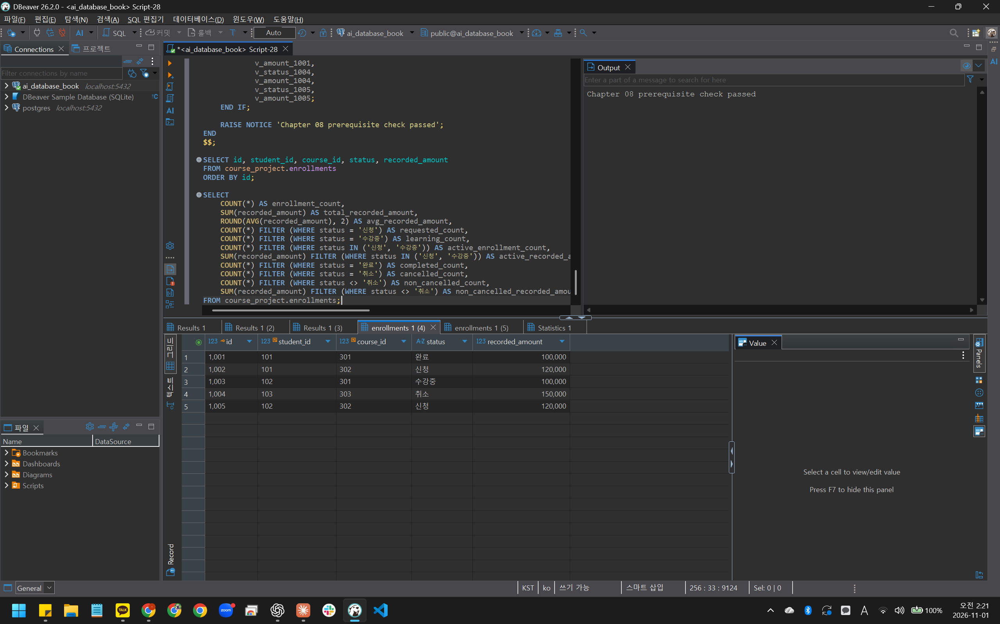
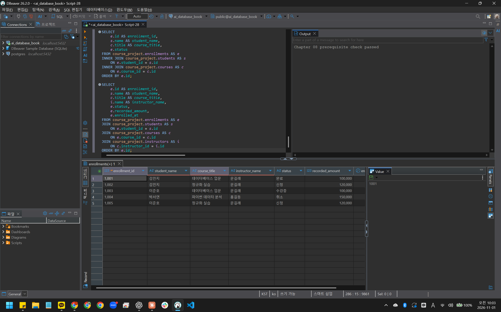
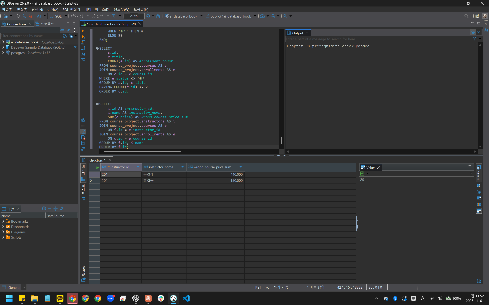
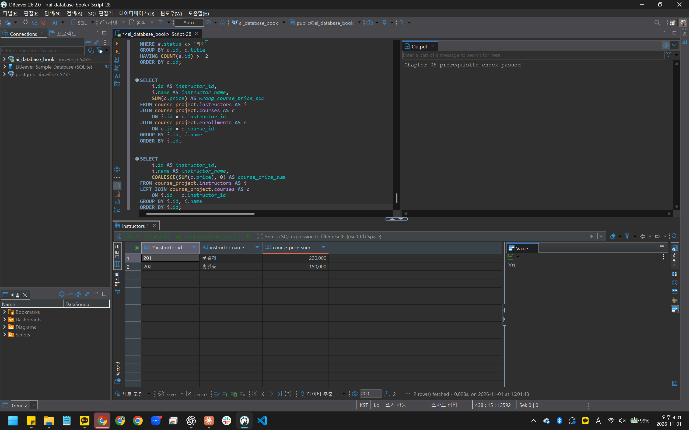

# Chapter 08 확장 실습 답안 템플릿

> **과제:** JOIN과 집계로 서비스 질문에 답하기  
> **사용 방법:** 이 파일을 내려받아 본인의 GitHub 저장소에 `chapter08_answer.md`라는 이름으로 저장한 뒤 실습하면서 바로 작성합니다.  
> **제출 방법:** LMS에는 파일을 직접 업로드하지 않고, **본인 GitHub 저장소의 `chapter08_answer.md` 파일 URL**을 제출합니다.

---

## 제출 전 주의

이 파일과 캡처 화면에는 실제 비밀번호, 전체 DB 접속 URL, API Key, 개인정보를 기록하지 않습니다.

```text
GitHub 계정 또는 별칭: rudah7725
과제 작성일: 2026-11-01
사용한 AI 도구: ChatGPT
```

---

# 1. Chapter 07 기준 상태 확인

다음을 실행합니다.

```text
code/chapter08/00_check_course_project.sql
```

## 1-1. 사전 검사 결과

```text
검증 메시지: Chapter 08 prerequisite check passed

students 행 수: 3
instructors 행 수: 2
courses 행 수: 3
enrollments 행 수: 5

전체 신청 건수: 5
전체 recorded_amount: 590000
활성 신청 건수: 3
활성 recorded_amount: 340000
취소 제외 신청 건수: 4
취소 제외 recorded_amount: 440000
```

기준값:

```text
students = 3
instructors = 2
courses = 3
enrollments = 5

전체 = 5 / 590000
활성 = 3 / 340000
취소 제외 = 4 / 440000
```

### 기준값이 다르면 그대로 진행하면 안 되는 이유

```text
기준 데이터가 다르면 이후 JOIN과 집계 결과도 달라져, SQL의 문제인지 데이터 상태의 차이인지 구분하기 어렵기 때문이다.
```

### 증거 화면

권장 경로:

```text
assignments/chapter08/images/step01_prerequisite.png
```



---

# 2. 업무 질문을 SQL보다 먼저 정의하기

다음 세 질문을 각각 SQL 작성 전에 먼저 정의합니다.

## 질문 A

```text
업무 질문: 전체 수강신청마다 학생 이름과 강의 제목을 조회한다.
결과 한 행의 의미: 수강신청 한 건이다.
포함 상태: 신청, 수강중, 완료, 취소
제외 상태: 없음
JOIN할 테이블: enrollments, students, courses
JOIN 경로: enrollments.student_id = students.id, enrollments.course_id = courses.id
INNER JOIN / LEFT JOIN 선택: INNER JOIN
그 이유: 신청에 연결된 학생과 강의를 조회하며, 사전 검사에서 부모 없는 신청이 없음을 확인했기 때문이다.
예상 행 수: 5행
```

## 질문 B

```text
업무 질문: 모든 강의의 취소 제외 신청 건수와 기록 금액 합계를 조회한다.
결과 한 행의 의미: 강의 한 개이다.
포함 상태: 신청, 수강중, 완료
제외 상태: 취소
JOIN할 테이블: courses, enrollments
JOIN 경로: courses.id = enrollments.course_id로 연결하고, 취소 제외 조건을 ON에 둔다. 신청이 0건인 강의도 표시하도록 LEFT JOIN한다.
집계 대상: 연결된 enrollments.id의 개수와 recorded_amount의 합계이다.
예상 결과: 3행이다. 강의 301은 2건과 200000원, 302는 2건과 240000원, 303은 0건과 0원이다.
```

## 질문 C

```text
업무 질문: 취소 제외 신청이 없는 학생도 포함하여 모든 학생의 취소 제외 신청 건수를 조회한다.
결과 한 행의 의미: 학생 한 명이다.
포함 상태: 신청, 수강중, 완료
제외 상태: 취소
0건인 부모도 보여야 하는가: 보여야 한다. students를 기준으로 enrollments를 LEFT JOIN하고, 취소 제외 조건을 ON에 둔다.
NULL을 어떻게 해석할 것인가: 연결된 신청 id가 NULL이면 해당 학생에게 취소 제외 신청이 없다는 뜻이다. 신청 id를 세면 0건으로 집계된다.
예상 결과: 3행이다. 김민지는 2건, 이준호는 2건, 박서연은 0건이다.
```

---

# 3. INNER JOIN과 다중 JOIN

## 3-1. 신청 한 건마다 학생 이름과 강의 제목 조회

실행 전 예상:

```text
결과 한 행 = 수강신청 한 건
예상 행 수 = 5행
JOIN 경로 = enrollments.student_id → students.id, enrollments.course_id → courses.id
```

내가 실행한 SQL:

```sql
SELECT
    e.id AS enrollment_id,
    s.name AS student_name,
    c.title AS course_title,
    e.status
FROM course_project.enrollments AS e
INNER JOIN course_project.students AS s
    ON e.student_id = s.id
INNER JOIN course_project.courses AS c
    ON e.course_id = c.id
ORDER BY e.id;
```

실제 결과:

```text
실제 행 수: 5행
예상과 일치 여부: 예상과 일치했다. 취소를 포함한 신청 5건이 모두 조회되었다.
```

### 학생 이름이 여러 번 보이는 것이 중복 오류가 아닐 수 있는 이유

```text
결과 한 행은 학생 한 명이 아니라 수강신청 한 건이다. 김민지와 이준호는 각각 두 강의를 신청했으므로 이름이 두 번씩 나타났다. 신청 id가 서로 다르므로 같은 신청이 중복으로 조회된 것은 아니다.
```

## 3-2. 학생·강의·강사까지 연결

```text
결과 한 행 = 수강신청 한 건
강사까지 가는 JOIN 경로 = enrollments.course_id → courses.id, courses.instructor_id → instructors.id
```

```sql
SELECT
    e.id AS enrollment_id,
    s.name AS student_name,
    c.title AS course_title,
    i.name AS instructor_name,
    e.status,
    e.recorded_amount,
    e.enrolled_at
FROM course_project.enrollments AS e
JOIN course_project.students AS s
    ON e.student_id = s.id
JOIN course_project.courses AS c
    ON e.course_id = c.id
JOIN course_project.instructors AS i
    ON c.instructor_id = i.id
ORDER BY e.id;
```

실제 행 수:

```text
5행으로 예상과 일치했다. 강사까지 연결한 뒤에도 신청 5건이 모두 유지되었다.
```

### 증거 화면

권장 경로:

```text
assignments/chapter08/images/step03_inner_join.png
```



---

# 4. LEFT JOIN과 0건 표현

## 4-1. 강의별 취소 제외 신청 수

신청이 없는 강의도 결과에 남도록 작성합니다.

실행 전:

```text
결과 한 행 = 강의 한 개
강의 303의 예상 실제 신청 수 = 0건
강의 303의 예상 고유 학생 수 = 0명
강의 303의 예상 recorded_amount = 0원
```

내 SQL:

```sql
SELECT
    c.id AS course_id,
    c.title AS course_title,
    COUNT(e.id) AS non_cancelled_count,
    COUNT(DISTINCT e.student_id) AS student_count,
    COALESCE(SUM(e.recorded_amount), 0) AS non_cancelled_recorded_amount
FROM course_project.courses AS c
LEFT JOIN course_project.enrollments AS e
    ON c.id = e.course_id
   AND e.status <> '취소'
GROUP BY c.id, c.title
ORDER BY c.id;
```

실제 결과:

```text
강의 301: 취소 제외 신청 2건, 고유 학생 2명, 기록 금액 합계 200000원이다.
강의 302: 취소 제외 신청 2건, 고유 학생 2명, 기록 금액 합계 240000원이다.
강의 303: 취소 제외 신청 0건, 고유 학생 0명, 기록 금액 합계 0원이다.
```

## 4-2. `COUNT(*)`와 `COUNT(e.id)` 비교

강의 303을 기준으로 작성합니다.

```text
COUNT(*) 결과: 1
COUNT(e.id) 결과: 0
COUNT(DISTINCT e.student_id) 결과: 0
```

### 왜 `COUNT(*) = 1`인데 실제 신청 수는 0일 수 있나요?

```text
강의 303에는 취소 제외 조건에 맞는 신청이 없지만, LEFT JOIN이 강의 행을 남긴다. 이 행의 신청 정보는 NULL이다. COUNT(*)는 남아 있는 행을 세므로 1이고, COUNT(e.id)는 NULL을 세지 않으므로 0이다.
```

### 자식 사건 수를 셀 때 `COUNT(child.id)`가 더 적절한 이유

```text
COUNT(*)는 연결된 자식이 없어도 남아 있는 부모 행을 센다. COUNT(child.id)는 NULL이 아닌 자식 id만 세므로, 이번 조회에서 실제 연결된 신청 건수를 구하는 데 적절하다.
```

---

# 5. `LEFT JOIN`에서 `ON`과 `WHERE` 조건 비교

취소 제외 신청만 연결한다고 가정합니다.

## 5-1. 조건을 `ON`에 둔 경우

```sql
SELECT
    s.id,
    s.name,
    COUNT(e.id) AS non_cancelled_count
FROM course_project.students AS s
LEFT JOIN course_project.enrollments AS e
    ON s.id = e.student_id
   AND e.status <> '취소'
GROUP BY s.id, s.name
ORDER BY s.id;
```

```text
결과 학생 수: 3명
박서연 포함 여부: 포함되었다. 취소 제외 신청 건수는 0건이다.
```

## 5-2. 조건을 `WHERE`에 둔 경우

```sql
SELECT
    s.id,
    s.name,
    COUNT(e.id) AS non_cancelled_count
FROM course_project.students AS s
LEFT JOIN course_project.enrollments AS e
    ON s.id = e.student_id
WHERE e.status <> '취소'
GROUP BY s.id, s.name
ORDER BY s.id;
```

```text
결과 학생 수: 2명
박서연 포함 여부: 포함되지 않았다.
```

## 5-3. 차이 설명

```text
ON 조건이 LEFT JOIN의 오른쪽 연결 대상을 제한하는 방식:
취소되지 않은 신청만 연결한다. 조건에 맞는 신청이 없어도 왼쪽 학생은 남는다.

WHERE 조건이 JOIN 이후 결과 행을 제거하는 방식:
학생과 신청을 연결한 결과에서 취소 제외 조건을 만족하는 행만 남긴다.

이번 사례에서 ON = 3명, WHERE = 2명이 되는 이유:
박서연은 취소된 신청만 있다. ON에 조건을 두면 연결되는 신청 없이 학생 행이 남아 0건으로 표시된다. WHERE에 조건을 두면 연결된 취소 신청 행이 제거되어 박서연이 결과에서 빠진다.
```

---

# 6. 신청이 없는 학생 찾기 — 두 방법 비교

## 방법 1. `LEFT JOIN ... IS NULL`

```sql
SELECT
    s.id,
    s.name,
    s.email
FROM course_project.students AS s
LEFT JOIN course_project.enrollments AS e
    ON s.id = e.student_id
   AND e.status <> '취소'
WHERE e.id IS NULL;
```

## 방법 2. `NOT EXISTS`

```sql
SELECT
    s.id,
    s.name,
    s.email
FROM course_project.students AS s
WHERE NOT EXISTS (
    SELECT 1
    FROM course_project.enrollments AS e
    WHERE e.student_id = s.id
      AND e.status <> '취소'
);
```

```text
방법 1 결과: 박서연(id 103) 1명이 조회되었다.
방법 2 결과: 박서연(id 103) 1명이 조회되었다.
두 결과가 같은가: 두 방법 모두 같은 학생 1명을 조회했다.
찾아진 학생: 박서연(id 103)
```

### 두 방식의 공통 의미를 자신의 말로 설명

```text
두 방식 모두 취소되지 않은 신청이 한 건도 없는 학생을 찾는다. LEFT JOIN 방식은 연결된 신청 id가 NULL인지 확인하고, NOT EXISTS 방식은 조건에 맞는 신청이 존재하지 않는지 확인한다. 박서연은 취소된 신청만 있으므로 두 결과에 모두 포함된다.
```

---

# 7. 기본 집계 검산

다음 결과를 직접 확인합니다.

| 분석 범위 | 예상 건수 | 실제 건수 | 예상 금액 | 실제 금액 | 일치? |
| --- | ---: | ---: | ---: | ---: | --- |
| 전체 신청 | 5 | 5 | 590000 | 590000 | 일치 |
| 활성 신청 | 3 | 3 | 340000 | 340000 | 일치 |
| 취소 제외 | 4 | 4 | 440000 | 440000 | 일치 |
| 취소 | 1 | 1 | 150000 | 150000 | 일치 |

## 7-1. 전체 평균 `recorded_amount`

```text
예상 평균: 118000원
실제 평균: 118000원
```

## 7-2. 취소 제외 평균

```text
예상 평균: 110000원
실제 평균: 110000원
```

### `recorded_amount`를 실제 회계 매출이라고 부르면 안 되는 이유

```text
recorded_amount는 신청 당시 기록한 금액이다. 실제 결제 여부와 환불 내역을 확인한 금액이 아니므로 실제 회계 매출이라고 부를 수 없다.
```

---

# 8. `GROUP BY`, `HAVING`, `FILTER`

## 8-1. 상태별 신청 건수

```sql
SELECT
    status,
    COUNT(*) AS enrollment_count,
    SUM(recorded_amount) AS total_recorded_amount
FROM course_project.enrollments
GROUP BY status
ORDER BY CASE status
    WHEN '신청' THEN 1
    WHEN '수강중' THEN 2
    WHEN '완료' THEN 3
    WHEN '취소' THEN 4
    ELSE 99
END;
```

결과:

```text
신청: 2건
수강중: 1건
완료: 1건
취소: 1건
상태별 합계: 5건
```

### 상태별 건수 합이 전체 신청 5건과 맞는지 검산

```text
상태별 건수를 더하면 2 + 1 + 1 + 1 = 5건으로 전체 신청 건수와 일치했다. 기록 금액도 240000 + 100000 + 100000 + 150000 = 590000원으로 전체 합계와 일치했다.
```

## 8-2. 강의별 취소 제외 신청 수와 금액

```sql
SELECT
    c.id AS course_id,
    c.title AS course_title,
    COUNT(e.id) AS non_cancelled_count,
    COUNT(DISTINCT e.student_id) AS student_count,
    COALESCE(SUM(e.recorded_amount), 0) AS non_cancelled_recorded_amount
FROM course_project.courses AS c
LEFT JOIN course_project.enrollments AS e
    ON c.id = e.course_id
   AND e.status <> '취소'
GROUP BY c.id, c.title
ORDER BY c.id;
```

```text
강의 301: 취소 제외 신청 2건, 기록 금액 합계 200000원이다.
강의 302: 취소 제외 신청 2건, 기록 금액 합계 240000원이다.
강의 303: 취소 제외 신청 0건, 기록 금액 합계 0원이다.
강의별 합계를 다시 더한 값: 신청 4건, 기록 금액 440000원이다.
전체 취소 제외 기준 440000과 일치 여부: 200000 + 240000 + 0 = 440000원으로 일치했다.
```

## 8-3. `HAVING` 사용

취소 제외 신청이 2건 이상인 강의를 조회합니다.

```sql
SELECT
    c.id,
    c.title,
    COUNT(e.id) AS enrollment_count
FROM course_project.courses AS c
JOIN course_project.enrollments AS e
    ON c.id = e.course_id
WHERE e.status <> '취소'
GROUP BY c.id, c.title
HAVING COUNT(e.id) >= 2
ORDER BY c.id;
```

```text
예상 강의 수: 2개
실제 강의 수: 2개이다. 데이터베이스 입문(301)과 정규화 실습(302)이 각각 취소 제외 신청 2건으로 조회되었다.
```

---

# 9. 과대 집계 오류 직접 관찰

강사 201의 강의 가격 합계를 구한다고 가정합니다.

## 9-1. 신청까지 JOIN해서 잘못 집계한 결과

```sql
SELECT
    i.id AS instructor_id,
    i.name AS instructor_name,
    SUM(c.price) AS wrong_course_price_sum
FROM course_project.instructors AS i
JOIN course_project.courses AS c
    ON i.id = c.instructor_id
JOIN course_project.enrollments AS e
    ON c.id = e.course_id
GROUP BY i.id, i.name
ORDER BY i.id;
```

```text
강사 201 잘못된 가격 합계: 440000원
```

본문 기준:

```text
440000
```

## 9-2. 강의 수준에서 올바르게 집계

```sql
SELECT
    i.id AS instructor_id,
    i.name AS instructor_name,
    COALESCE(SUM(c.price), 0) AS course_price_sum
FROM course_project.instructors AS i
LEFT JOIN course_project.courses AS c
    ON i.id = c.instructor_id
GROUP BY i.id, i.name
ORDER BY i.id;
```

```text
강사 201 올바른 가격 합계: 220000원
```

본문 기준:

```text
220000
```

## 9-3. 왜 두 결과가 달라졌나요?

```text
JOIN 전 강의 행 수: 강사 201의 강의는 2행이다.
JOIN 후 강의가 반복된 이유: 두 강의에 신청이 각각 2건씩 있어, 신청까지 JOIN하면 4행이 된다.
SUM이 무엇을 반복해서 더했는가: 강의 가격 100000원과 120000원을 각각 두 번씩 더해 440000원이 되었다.
```

### `SUM(DISTINCT c.price)`를 일반적인 해결책으로 사용하면 안 되는 이유

```text
DISTINCT는 강의가 아니라 같은 가격 값을 중복 제거한다. 서로 다른 강의의 가격이 같으면 한 번만 더하므로 합계가 실제보다 작아질 수 있다.
```

### 증거 화면

권장 경로:

```text
assignments/chapter08/images/step09_over_aggregation.png
```





---

# 10. 상세 결과 ↔ 집계 결과 교차 검산

강의 하나를 선택합니다.

```text
선택한 course_id: 301
강의 제목: 데이터베이스 입문
```

## 10-1. 상세 신청 행 조회

```sql
SELECT
    e.id AS enrollment_id,
    s.name AS student_name,
    c.title AS course_title,
    e.status,
    e.recorded_amount
FROM course_project.enrollments AS e
JOIN course_project.students AS s
    ON e.student_id = s.id
JOIN course_project.courses AS c
    ON e.course_id = c.id
WHERE e.course_id = 301
  AND e.status <> '취소'
ORDER BY e.id;
```

```text
상세 행 수: 2행
상세 recorded_amount를 직접 더한 값: 100000 + 100000 = 200000원
```

## 10-2. 집계 SQL

```sql
SELECT
    COUNT(*) AS enrollment_count,
    SUM(recorded_amount) AS total_recorded_amount
FROM course_project.enrollments
WHERE course_id = 301
  AND status <> '취소';
```

```text
집계 건수: 2건
집계 금액: 200000원
```

## 10-3. 비교

```text
상세 행 수와 COUNT 결과 일치 여부: 상세 조회 2행과 COUNT 결과 2건이 일치했다.
상세 금액 합과 SUM 결과 일치 여부: 직접 더한 200000원과 SUM 결과 200000원이 일치했다.
다르다면 원인: 차이가 없었다. 두 조회 모두 강의 301의 취소 제외 신청을 대상으로 했다.
```

---

# 11. 자동 완료 게이트

다음을 실행합니다.

```text
code/chapter08/03_join_aggregation_validation.sql
```

```text
최종 검증 메시지: Chapter 08 join and aggregation validation passed
```

기대 메시지:

```text
Chapter 08 join and aggregation validation passed
```

### 자동 검증이 통과했어도 사람이 SQL 의미를 설명해야 하는 이유

```text
자동 검증은 미리 정한 조건과 결과가 맞는지 확인한다. 하지만 조회 대상과 포함할 상태, JOIN으로 생긴 중복이나 누락이 업무 질문의 의도에 맞는지는 사람이 확인하고 설명해야 한다.
```

---

# 12. 개인 프로젝트 업무 질문 3개 만들기

Chapter 07에서 작성한 개인 프로젝트를 사용합니다.

| 질문 ID | 업무 질문 | 결과 한 행 | 포함/제외 범위 | JOIN 경로 | 집계 대상 | 검산 방법 |
| --- | --- | --- | --- | --- | --- | --- |
| P08-Q01 | 주문이 없는 가맹점도 포함해서 가맹점별 주문 건수는 몇 건인가? | 가맹점 한 곳의 주문 건수 | 모든 가맹점과 모든 상태의 주문을 포함한다. 기간 제한은 두지 않는다. | stores에서 orders로 LEFT JOIN한다. | COUNT(orders.order_id)로 주문 건수를 센다. | 주문 상세를 연결하지 않고 orders에서 가맹점별 주문 건수를 직접 세어 비교한다. 주문이 없는 가맹점은 0건인지 확인한다. |
| P08-Q02 | 주문이 없는 가맹점도 포함해서 가맹점별 할인 전 판매 금액 합계는 얼마인가? | 가맹점 한 곳의 할인 전 판매 금액 합계 | 기간과 주문 상태에 따른 제외 없이 모든 주문 항목을 포함한다. 할인, 취소와 환불을 반영한 실제 매출은 아니다. | stores → orders → order_items를 LEFT JOIN한다. | 주문 항목의 quantity × unit_price_at_order 합계 | 주문별 항목 금액을 손으로 계산한 뒤 가맹점별로 더해 비교한다. |
| P08-Q03 | 주문별 할인 전 판매 금액과 할인을 한 번 차감한 금액은 얼마인가? | 주문 한 건의 할인 전 금액, 할인 금액과 할인 후 금액 | 주문 항목이 있는 모든 주문을 포함한다. 기간과 상태 제한은 없으며, 취소와 환불은 반영하지 않는다. | orders와 order_items를 INNER JOIN한다. | 주문별 항목 금액을 합산하고 주문의 discount_amount를 한 번 뺀다. | 주문별 항목 금액을 손으로 더하고 할인을 한 번 뺀 값과 비교한다. 항목이 여러 줄이어도 할인이 중복 차감되지 않는지 확인한다. |

## 12-1. 질문 1 SQL

```sql
SELECT
    s.store_id,
    s.store_name,
    COUNT(o.order_id) AS order_count
FROM stores AS s
LEFT JOIN orders AS o
    ON s.store_id = o.store_id
GROUP BY s.store_id, s.store_name
ORDER BY s.store_id;
```

```text
예상 결과: 기존 시나리오 데이터를 넣었다면 강남점 3건, 신촌점 0건이다.
실제 결과: 미실행. 개인 프로젝트 테이블은 아직 설계 단계라 DB에 만들지 않았다.
검산 결과: 미실행. 실행 시 orders에서 가맹점별 주문 건수를 직접 세어 비교하고, 주문이 없는 가맹점도 0건으로 나오는지 확인할 예정이다.
```

## 12-2. 질문 2 SQL

```sql
SELECT
    s.store_id,
    s.store_name,
    COALESCE(
        SUM(oi.quantity * oi.unit_price_at_order), 0
    ) AS gross_sales_amount
FROM stores AS s
LEFT JOIN orders AS o
    ON s.store_id = o.store_id
LEFT JOIN order_items AS oi
    ON o.order_id = oi.order_id
GROUP BY s.store_id, s.store_name
ORDER BY s.store_id;
```

```text
예상 결과: 기존 시나리오 데이터를 넣었다면 강남점 26500원, 신촌점 0원이다.
실제 결과: 미실행. 개인 프로젝트 테이블은 아직 설계 단계라 DB에 만들지 않았다.
검산 결과: 미실행. 강남점의 주문별 금액 14000원, 6000원, 6500원을 더한 26500원과 비교하고, 주문이 없는 신촌점은 0원인지 확인할 예정이다.
```

## 12-3. 질문 3 SQL

```sql
SELECT
    o.order_id,
    SUM(oi.quantity * oi.unit_price_at_order)
        AS gross_sales_amount,
    o.discount_amount,
    SUM(oi.quantity * oi.unit_price_at_order)
        - o.discount_amount AS net_sales_amount
FROM orders AS o
INNER JOIN order_items AS oi
    ON o.order_id = oi.order_id
GROUP BY o.order_id, o.discount_amount
ORDER BY o.order_id;
```

```text
예상 결과: 기존 시나리오에서 주문 1, 2, 3의 할인 전 금액은 각각 14000원, 6000원, 6500원이다. 할인 금액을 모두 0으로 둔 경우 할인 후 금액도 같다.
실제 결과: 미실행. 개인 프로젝트 테이블은 아직 설계 단계라 DB에 만들지 않았다.
검산 결과: 미실행. 주문별 항목 금액을 직접 더한 뒤 할인 금액을 한 번 빼서 비교할 예정이다. 추가 검산용으로 항목이 두 줄인 주문 1의 할인을 1000원으로 두면 할인 후 금액이 13000원인지 확인할 예정이다.
```

> 아직 개인 프로젝트 테이블을 PostgreSQL로 완성하지 않았다면 SQL 초안과 예상 검산 방법까지만 작성하고 `미실행`이라고 명시합니다.

---

# 13. AI를 JOIN·집계 리뷰어로 활용

## 13-1. 내가 AI에게 전달한 질문

```text
12번에서 함께 작성한 개인 프로젝트 SQL 세 개를 검토해 줘. 테이블은 아직 설계 단계이므로 실행 결과를 만들어내지 말아 줘.

1. 가맹점별 주문 건수는 주문이 없는 가맹점도 포함해야 한다.
2. 가맹점별 할인 전 판매 금액은 수량과 주문 당시 단가로 계산해야 한다.
3. 주문별 할인 후 금액은 주문 항목이 있는 주문을 대상으로, 항목 금액을 합산한 뒤 주문 할인을 한 번만 빼야 한다.

세 질문 모두 기간과 주문 상태에 따른 제외는 하지 않는다. 취소와 환불의 매출 반영 정책은 아직 미확정이다.

결과 한 행의 의미, JOIN 경로, INNER JOIN과 LEFT JOIN 선택, COUNT 대상, 중복 합산과 누락 위험, 상세 검산 방법을 확인해 줘. 미확정 정책은 임의로 확정하지 말아 줘.

검토 대상 SQL 1:
SELECT
    s.store_id,
    s.store_name,
    COUNT(o.order_id) AS order_count
FROM stores AS s
LEFT JOIN orders AS o
    ON s.store_id = o.store_id
GROUP BY s.store_id, s.store_name
ORDER BY s.store_id;

검토 대상 SQL 2:
SELECT
    s.store_id,
    s.store_name,
    COALESCE(
        SUM(oi.quantity * oi.unit_price_at_order), 0
    ) AS gross_sales_amount
FROM stores AS s
LEFT JOIN orders AS o
    ON s.store_id = o.store_id
LEFT JOIN order_items AS oi
    ON o.order_id = oi.order_id
GROUP BY s.store_id, s.store_name
ORDER BY s.store_id;

검토 대상 SQL 3:
SELECT
    o.order_id,
    SUM(oi.quantity * oi.unit_price_at_order)
        AS gross_sales_amount,
    o.discount_amount,
    SUM(oi.quantity * oi.unit_price_at_order)
        - o.discount_amount AS net_sales_amount
FROM orders AS o
INNER JOIN order_items AS oi
    ON o.order_id = oi.order_id
GROUP BY o.order_id, o.discount_amount
ORDER BY o.order_id;
```

## 13-2. 내 SQL과 AI SQL 비교

| 검토 항목 | 내 판단/SQL | AI 제안 | 최종 선택 | 이유 |
| --- | --- | --- | --- | --- |
| 결과 한 행 | 질문 1과 2는 가맹점, 질문 3은 주문 한 건이다. | 이름만이 아니라 식별자로 구분한다. | 수용, 기존 SQL 유지 | 같은 이름이어도 다른 가맹점과 주문을 구분해야 한다. |
| 상태 범위 | 기간과 상태 제한을 두지 않았다. | 취소와 환불을 반영한 실제 매출과 구분한다. | 수용 | 매출 반영 정책은 아직 미확정이다. |
| JOIN 경로 | 질문별로 필요한 주문과 주문 항목만 연결했다. | 점주 등 집계에 필요 없는 관계는 추가하지 않는다. | 수용, 기존 경로 유지 | 다른 관계까지 연결하면 같은 항목이 반복될 수 있다. |
| INNER/LEFT 선택 | 질문 1과 2는 LEFT JOIN, 질문 3은 INNER JOIN이다. | 0건 가맹점은 남기고, 질문 3은 항목이 있는 주문만 조회한다. | 수용 | 각 질문의 포함 범위와 맞는다. |
| COUNT 대상 | 질문 1에서 COUNT(o.order_id)를 사용했다. | COUNT(*)로 바꾸지 않는다. | 수용 | 주문이 없는 가맹점의 결과 행을 주문 1건으로 세면 안 된다. |
| 과대 집계 위험 | 항목 금액을 합산한 뒤 주문 할인을 한 번 뺐다. | 할인 금액을 SUM에 넣지 않는다. | 수용 | 주문 할인이 항목 수만큼 중복 차감될 수 있다. |
| 상세 검산 방법 | 주문 건수와 항목 금액을 직접 계산해 비교할 예정이다. | 항목이 두 줄인 주문에 할인 1000원을 가정해 검산한다. | 수용, 미실행 | 할인이 한 번만 차감되는지 확인할 수 있다. |

### AI가 만든 SQL에서 발견한 위험 또는 확인한 점

```text
주문과 주문 항목을 JOIN하면 주문의 할인 금액이 항목마다 반복된다. 질문 3은 항목 금액을 합산한 뒤 할인을 한 번만 빼므로 중복 차감을 피했다. 항목이 없는 주문은 제외되지만 질문에서 정한 범위와 맞는다. 수량이 NULL이면 해당 항목 금액이 합계에서 빠질 수 있으므로, 실제 구현 전 수량의 NULL 허용 여부는 추가로 확인해야 한다.
```

### AI SQL이 실행 성공했다고 바로 정답이라고 할 수 없는 이유

```text
SQL이 실행되어도 JOIN으로 행이 중복되거나 필요한 대상이 빠질 수 있다. 결과 한 행의 의미와 집계 범위가 업무 질문에 맞는지 확인하고, 상세 기록을 직접 계산한 값과 비교해야 한다. 이번 개인 프로젝트 SQL은 아직 미실행이므로 실제 결과까지 검증한 것은 아니다.
```

---

# 14. 최종 성찰

아래 문장은 본인의 말로 작성합니다.

```text
1. JOIN SQL을 작성하기 전에 가장 먼저 정해야 하는 것은
   결과 한 행의 의미와 포함하거나 제외할 데이터 범위 이다.

2. LEFT JOIN에서 COUNT(*) 대신 COUNT(child.id)를 검토해야 하는 이유는
   연결된 자식이 없어도 부모 행은 남아 COUNT(*)가 1로 셀 수 있기 때문 이다.

3. ON과 WHERE 조건 위치가 중요한 이유는
   조건 위치에 따라 연결할 자식이 없는 부모 행이 결과에 남거나 빠질 수 있기 때문 이다.

4. 여러 1:N 관계를 JOIN한 뒤 바로 SUM하면 위험한 이유는
   같은 값이 여러 행에 반복되어 합계가 실제보다 커질 수 있기 때문 이다.

5. 집계 결과를 신뢰하기 전에 가장 좋은 검산 방법 중 하나는
   같은 조건의 상세 기록을 조회해 건수와 금액을 직접 계산하고 비교하는 것 이다.
```

---

# 15. 제출 체크리스트

- [x] `chapter08_answer.md`를 본인 저장소에 만들었다.
- [x] `00_check_course_project.sql`이 통과했다.
- [x] 업무 질문마다 결과 한 행을 먼저 정의했다.
- [x] INNER JOIN과 다중 JOIN을 실행했다.
- [x] LEFT JOIN에서 0건 부모를 확인했다.
- [x] `COUNT(*)`와 `COUNT(child.id)` 차이를 설명했다.
- [x] ON과 WHERE 조건 위치 차이를 직접 비교했다.
- [x] `LEFT JOIN ... IS NULL`과 `NOT EXISTS`를 비교했다.
- [x] 전체/활성/취소 제외 기준값을 직접 검산했다.
- [x] `GROUP BY`, `HAVING`을 사용했다.
- [x] 과대 집계 오류와 수정 결과를 비교했다.
- [x] 상세 결과와 집계 결과를 교차 검산했다.
- [x] `03_join_aggregation_validation.sql`이 통과했다.
- [x] 개인 프로젝트 업무 질문 3개를 작성했다.
- [x] AI SQL을 실행 성공 여부가 아니라 의미와 검산 결과로 평가했다.
- [x] 핵심 캡처는 3~4장 정도만 사용했다.
- [x] 비밀번호·개인정보·비밀정보가 없다.
- [ ] GitHub 웹에서 Markdown과 이미지가 정상적으로 보인다.
- [ ] 최종 답안을 commit/push했다.

---

# 16. LMS 제출 URL

아래 형식의 **본인 GitHub 파일 URL**을 LMS에 제출합니다.

```text
https://github.com/<본인-GitHub-ID>/<본인-저장소>/blob/main/assignments/chapter08/chapter08_answer.md
```

내 제출 URL:

```text
https://github.com/rudah7725/database-course-2026-2/blob/main/assignments/chapter08/chapter08_answer.md
```

> 저장소 메인 URL, 교수자 템플릿 URL, Raw URL이 아니라 **작성 완료된 본인 `chapter08_answer.md` 파일 화면 URL**을 제출합니다.
