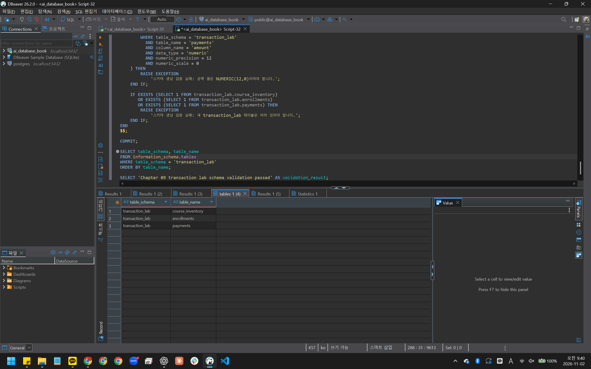
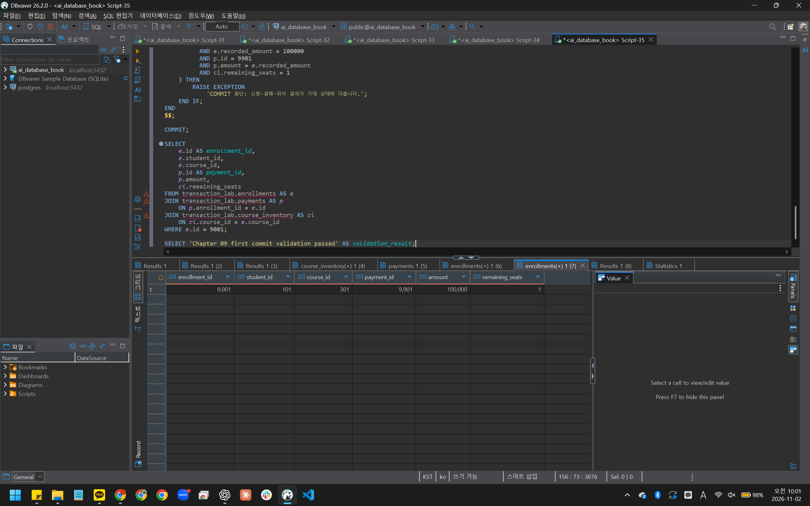
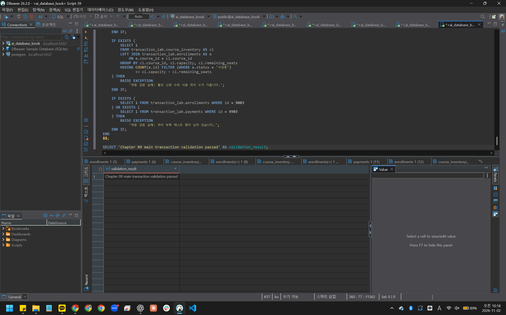
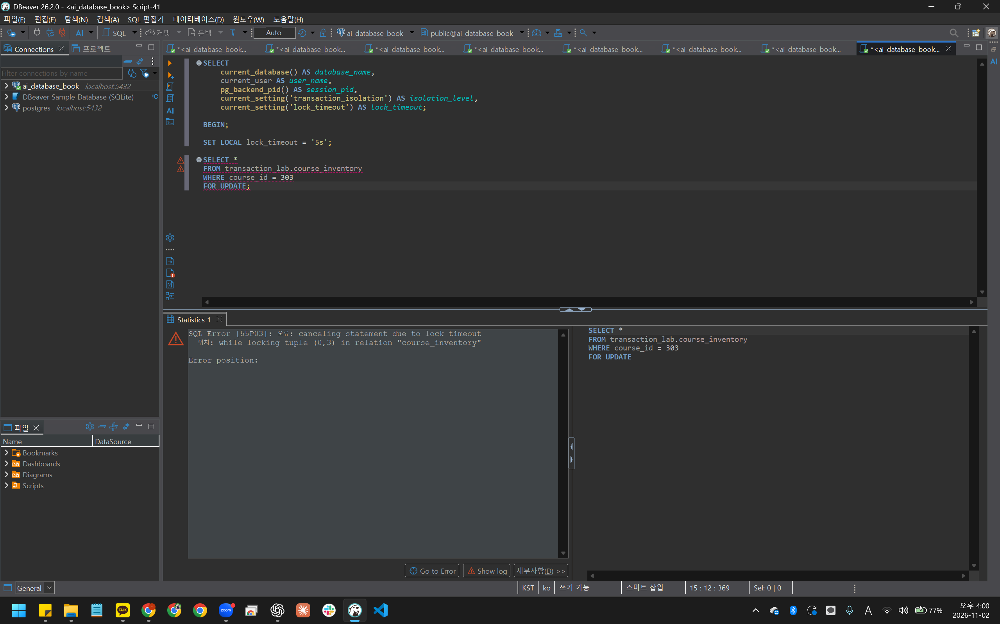

# Chapter 09 확장 실습 답안 템플릿

> **과제:** 트랜잭션으로 데이터 정합성 지키기  
> **사용 방법:** 이 파일을 내려받아 본인의 GitHub 저장소에 `chapter09_answer.md`라는 이름으로 저장한 뒤 실습하면서 바로 작성합니다.  
> **제출 방법:** LMS에는 파일을 직접 업로드하지 않고, **본인 GitHub 저장소의 `chapter09_answer.md` 파일 URL**을 제출합니다.

---

## 제출 전 주의

이 파일과 캡처 화면에는 실제 비밀번호, 전체 DB 접속 URL, API Key, 개인정보를 기록하지 않습니다.

```text
GitHub 계정 또는 별칭: rudah7725
과제 작성일: 2026-11-02
사용한 AI 도구: ChatGPT
```

---

# 1. 시작 환경과 Chapter 07·08 기준 상태 확인

다음을 실행하거나 Chapter 09의 `01_transaction_lab_schema.sql` 사전 검사를 확인합니다.

```sql
SELECT current_database();
SELECT current_user;
SELECT current_schema();
SHOW search_path;
SHOW transaction_read_only;
```

| 확인 항목 | 실제 결과 | 의미 |
| --- | --- | --- |
| `current_database()` | ai_database_book | 실습할 DB에 연결했다. |
| `current_user` | postgres | 현재 SQL 실행 사용자이다. |
| `current_schema()` | public | 현재 기본 스키마이다. |
| `search_path` | public, "$user" | 스키마를 생략하면 public, 사용자 이름의 스키마 순서로 찾는다. |
| `transaction_read_only` | off | 현재 트랜잭션이 읽기 전용 상태는 아니다. 모든 작업 권한을 보장하는 것은 아니다. |

Chapter 07·08 기준값:

```text
students = 3
instructors = 2
courses = 3
enrollments = 5
전체 recorded_amount = 590000
활성 = 3 / 340000
취소 제외 = 4 / 440000
```

### 기준 상태가 다르면 Chapter 09를 계속 진행하면 안 되는 이유

```text
기준 상태가 다르면 이후 실습 결과가 예상과 달라졌을 때 기존 데이터 때문인지 트랜잭션 처리 때문인지 구분하기 어렵다. 먼저 원인을 확인하고 기준 상태가 맞는지 검증한 뒤 진행해야 한다.
```

---

# 2. `transaction_lab` 스키마 생성

실행 파일:

```text
code/chapter09/01_transaction_lab_schema.sql
```

## 2-1. 생성 전 예상

```text
생성될 스키마: transaction_lab
생성될 테이블 3개: course_inventory, enrollments, payments

course_inventory 한 행의 의미: 강의 한 개의 정원과 남은 좌석 수이다.
enrollments 한 행의 의미: 학생 한 명이 강의 한 개에 신청한 기록 한 건이다.
payments 한 행의 의미: 수강신청 한 건에 대한 결제 기록 한 건이다.
```

## 2-2. 생성 결과

```text
통과 메시지: Chapter 09 transaction lab schema validation passed
```

기대 메시지:

```text
Chapter 09 transaction lab schema validation passed
```

### Chapter 07·08의 `course_project`와 별도 `transaction_lab`을 사용하는 이유

```text
Chapter 07과 08의 course_project 기준 데이터를 보존하면서 좌석, 수강신청, 결제 변경을 별도로 실습하기 위해서이다.
```

### 증거 화면

권장 경로:

```text
assignments/chapter09/images/step02_schema.png
```



---

# 3. 초기 좌석과 기준 데이터 입력

실행 파일:

```text
code/chapter09/02_transaction_lab_seed.sql
```

## 3-1. 실행 전 예상

```text
course 301 remaining_seats 예상: 3
course 302 remaining_seats 예상: 0
course 303 remaining_seats 예상: 0
lab enrollments 예상 행 수: 0
payments 예상 행 수: 0
```

## 3-2. 실제 결과

```text
course 301 remaining_seats: 2
course 302 remaining_seats: 1
course 303 remaining_seats: 1
lab enrollments 행 수: 0
payments 행 수: 0
통과 메시지: Chapter 09 transaction lab seed validation passed
```

기대 초기 상태:

```text
course 301 / 302 / 303 remaining_seats = 3 / 0 / 0
lab enrollments = 0
payments = 0
```

### 예상과 실제가 다른 경우 원인

```text
템플릿의 기대 초기 상태를 보고 남은 좌석을 3 / 0 / 0으로 예상했다. 실행 전 SQL을 확인하니 입력값과 검증값은 2 / 1 / 1이었다. 실제 결과도 2 / 1 / 1로 나왔고 검증을 통과했다. 차이는 템플릿과 제공 SQL의 초기값이 서로 달랐기 때문이다.
```

---

# 4. 첫 번째 정상 COMMIT 추적

실행 파일:

```text
code/chapter09/03_commit_transaction.sql
```

이 실습은 학생 101이 강의 301을 신청하는 하나의 업무 단위를 추적합니다.

## 4-1. 업무 단위 정의

```text
이 트랜잭션에서 함께 성공해야 하는 변경 1: 강의 301의 남은 좌석을 1개 줄이는 것이다.
변경 2: 학생 101의 강의 301 수강신청 기록을 생성하는 것이다.
변경 3: 해당 수강신청의 결제 기록을 생성하는 것이다.

하나라도 실패하면 전체를 취소해야 하는 이유: 좌석만 줄거나 신청과 결제 중 일부만 남으면 데이터가 서로 맞지 않기 때문이다.
```

## 4-2. 상태 변화 기록

| 시점 | course 301 남은 좌석 | lab enrollment 9001 | payment 9901 | 설명 |
| --- | ---: | --- | --- | --- |
| BEGIN 전 | 2 | 없음 | 없음 | 초기 좌석만 입력됐고 신청과 결제는 아직 생성되지 않았다. |
| 트랜잭션 내부 | 1 | 있음, 수강중 | 있음, 100000 | 좌석이 1개 줄고 신청과 결제가 생성됐다. 아직 COMMIT 전이다. |
| COMMIT 후 | 1 | 있음 | 있음, 100000 | COMMIT 후에도 좌석, 신청, 결제 변경이 유지됐다. |

## 4-3. COMMIT 조건

```text
좌석 UPDATE 기대 영향 행 수: 1행
실제 영향 행 수: 1행이다. 강의 301의 남은 좌석이 2에서 1로 줄었고, 이 UPDATE 결과를 사용하는 신청과 결제가 각각 1행 생성된 것으로 확인했다.
신청 생성 기대 행 수: 1행
결제 생성 기대 행 수: 1행
recorded_amount와 payment.amount 일치 여부: 둘 다 100000으로 일치했다.
최종 COMMIT 판단: 신청, 결제, 남은 좌석이 기대 상태와 일치하여 COMMIT했고 검증 통과 메시지를 확인했다.
```

기대 메시지:

```text
Chapter 09 first commit validation passed
```

### SQL 오류가 없었다는 사실만으로 COMMIT하면 안 되는 이유

```text
SQL 오류가 없어도 조건에 맞는 행이 없어 변경이 일어나지 않을 수 있다. 영향 행 수와 신청, 결제, 좌석의 관계가 기대 상태와 맞는지 확인한 뒤 COMMIT해야 한다.
```

### 증거 화면

권장 경로:

```text
assignments/chapter09/images/step04_commit.png
```



---

# 5. ROLLBACK으로 전체 원상복구 확인

실행 파일:

```text
code/chapter09/04_rollback_transaction.sql
```

## 5-1. ROLLBACK 전 예상

```text
트랜잭션 안에서 임시로 바뀔 값: 강의 302의 남은 좌석이 1에서 0으로 줄고, 신청 9002와 결제 9902가 생성될 것이다. 기록 금액과 결제 금액은 각각 120000일 것이다.
ROLLBACK 후 다시 돌아와야 할 값: 강의 302의 남은 좌석은 1로 돌아오고, 신청 9002와 결제 9902는 없어야 한다.
이미 이전 파일에서 COMMIT된 9001/9901은 유지되어야 하는가: 유지되어야 한다. 이번 ROLLBACK은 현재 트랜잭션의 변경만 취소하기 때문이다.
```

## 5-2. 실제 결과

```text
ROLLBACK 후 course 301 상태: 남은 좌석 1로 이전 COMMIT 상태를 유지했다.
ROLLBACK 후 lab enrollments 행 수: 1행
ROLLBACK 후 payments 행 수: 1행
9001 존재 여부: 존재했다.
9901 존재 여부: 존재했다.
통과 메시지: Chapter 09 rollback validation passed
```

기대 메시지:

```text
Chapter 09 rollback validation passed
```

## 5-3. ROLLBACK과 IDENTITY

```text
ROLLBACK이 테이블 행 변경을 되돌리는 방식:
현재 트랜잭션에서 실행한 INSERT, UPDATE, DELETE를 취소한다. 이번에는 임시 신청과 결제가 사라지고 강의 302의 남은 좌석이 1로 돌아왔다. 이전에 COMMIT한 변경은 유지됐다.

IDENTITY 자동 번호가 반드시 이전 값으로 되돌아가지는 않는 이유:
자동 번호를 만드는 시퀀스에서 이미 발급한 번호는 트랜잭션을 ROLLBACK해도 회수하지 않기 때문이다. 이번 실습은 ID를 직접 지정했으므로 자동 번호의 변화는 관찰하지 않았다.

번호가 건너뛰었다고 데이터 손상이라고 단정할 수 없는 이유:
ROLLBACK 등으로 행이 저장되지 않아도 발급된 번호는 사용된 상태로 남을 수 있다. 번호가 연속인지보다 실제 행과 데이터 관계가 올바른지 확인해야 한다.
```

---

# 6. 두 번째 COMMIT과 좌석 부족 0행 관찰

실행 파일:

```text
code/chapter09/05_commit_and_sold_out.sql
```

## 6-1. 두 번째 정상 COMMIT

```text
생성된 enrollment id: 9002
학생 id: 103
course id: 302
recorded_amount: 120000
payment id: 9902
payment amount: 120000
```

## 6-2. 좌석 부족 시도

```text
좌석 확보 UPDATE 기대 영향 행 수: 0행
실제 영향 행 수: 0행이다. 강의 302의 남은 좌석이 0이어서 UPDATE 조건에 맞지 않았고, 후속 결제 반환 결과도 0행이었다.
후속 enrollment 생성 행 수: 0행
후속 payment 생성 행 수: 0행
```

기준상 좌석 부족 시 생성되지 않아야 하는 ID:

```text
9003
9903
```

### `UPDATE 0`이 SQL 실패가 아니라 업무상 실패일 수 있는 이유

```text
SQL은 정상 실행돼도 조건에 맞는 행이 없으면 변경된 행은 0행이다. 이번에는 남은 좌석이 없어 좌석을 확보하지 못했으므로 수강신청 업무는 실패한 것이다.
```

### 영향 행 수가 0인데 신청과 결제를 계속 생성하면 어떤 정합성 문제가 생기나요?

```text
좌석을 확보하지 못한 신청과 결제가 생성되어 정원을 초과할 수 있다. 남은 좌석과 실제 수강신청 수가 맞지 않고, 수강할 수 없는 신청에 결제 기록이 남게 된다.
```

---

# 7. 주 실습 최종 정합성 검증

실행 파일:

```text
code/chapter09/06_transaction_validation.sql
```

## 7-1. lab 최종 상태

| 항목 | 기대값 | 실제값 | 일치? |
| --- | ---: | ---: | --- |
| course_inventory 행 수 | 3 | 3 | 일치 |
| lab enrollments 행 수 | 2 | 2 | 일치 |
| payments 행 수 | 2 | 2 | 일치 |
| course 301 remaining | 1 | 1 | 일치 |
| course 302 remaining | 0 | 0 | 일치 |
| course 303 remaining | 1 | 1 | 일치 |

## 7-2. 주요 행

```text
9001 = student 101 / course 301 / amount 100000 / payment 9901
실제: 학생 101, 강의 301, 신청 기록 금액 100000, 결제 9901, 결제 금액 100000으로 확인했다.

9002 = student 103 / course 302 / amount 120000 / payment 9902
실제: 학생 103, 강의 302, 신청 기록 금액 120000, 결제 9902, 결제 금액 120000으로 확인했다.

9003·9903 = 존재하지 않아야 함
실제: 최종 검증에서 존재하지 않음을 확인했다.
```

## 7-3. 보호 대상 확인

```text
course_project.enrollments 행 수: 5
전체 recorded_amount: 590000
활성 건수/금액: 3 / 340000
취소 제외 건수/금액: 4 / 440000
```

기대값:

```text
course_project.enrollments = 5
전체 = 590000
활성 = 3 / 340000
취소 제외 = 4 / 440000
```

최종 기대 메시지:

```text
Chapter 09 main transaction validation passed
```

### transaction_lab 실습 후에도 course_project 기준 상태를 다시 검사하는 이유

```text
transaction_lab 실습 중 course_project의 기준 데이터를 실수로 변경하지 않았는지 확인하기 위해서이다. 실습 후 건수와 신청 기록 금액을 다시 조회한 결과, 실습 전 기준값과 모두 일치했다.
```



---

# 8. ACID를 이번 실습으로 설명

교과서 정의를 그대로 복사하지 말고 이번 좌석·신청·결제 사례로 작성합니다.

```text
Atomicity:
좌석 감소, 수강신청 생성, 결제 기록 생성은 모두 함께 반영되거나 함께 취소되어야 한다. ROLLBACK 실습에서는 임시 신청과 결제가 사라지고 남은 좌석도 원래대로 복구됐다.

Consistency:
처리 후에도 남은 좌석은 0 이상 정원 이하여야 하고, 사용한 좌석 수와 활성 신청 수가 일치해야 한다. 이번 실습에서는 신청 기록 금액과 결제 금액도 일치함을 확인했다.

Isolation:
남은 좌석 하나에 여러 사람이 동시에 신청해도 정원을 초과하지 않도록 동시 처리가 제어되어야 한다. 이번 실습에서는 A가 강의 303 행의 잠금을 유지하는 동안 B의 잠금 요청에서 시간 초과가 발생했다. A가 ROLLBACK한 뒤 B에서 새 트랜잭션으로 재시도하자 조회에 성공했다. 실제 동시 신청에 따른 정원 초과 여부까지 시험한 것은 아니다.

Durability:
COMMIT으로 확정한 좌석, 신청, 결제 변경은 이후에도 유지되어야 한다. 앞서 COMMIT한 9001과 9901은 다음 트랜잭션을 ROLLBACK한 뒤에도 남아 있었다. 서버 재시작 후의 유지는 직접 시험하지 않았다.
```

### Atomicity와 Consistency가 같은 뜻이 아닌 이유

```text
Atomicity는 하나의 업무에 포함된 변경을 전부 반영하거나 전부 취소하는 성질이고, Consistency는 처리 후에도 데이터가 정해진 규칙을 지키는 성질이다. 좌석, 신청, 결제 변경을 모두 반영했더라도 남은 좌석이 음수가 됐다면 데이터 규칙을 지킨 것은 아니다.
```

---

# 9. 선택 실습 — 두 세션 Lock 대기 관찰

실행 파일:

```text
code/chapter09/07_concurrency_two_sessions.sql
```

가능하면 DBeaver에서 **서로 다른 두 연결 세션**으로 수행합니다.

## 9-1. 내 환경

```text
실제 두 세션 실습 수행 / 절차 분석만 수행: 실제 두 세션 실습을 수행했다. A는 Script-40(PID 8996), B는 Script-41(PID 23176)이었다.
transaction_isolation: 두 세션 모두 read committed였다.
lock_timeout: 초기값은 두 세션 모두 0이었고, B의 실습 트랜잭션에서는 SET LOCAL로 5s를 설정했다.
```

## 9-2. 시간 순서 기록

| 순서 | Session A | Session B | 관찰 |
| ---: | --- | --- | --- |
| 1 | BEGIN 후 강의 303을 SELECT FOR UPDATE로 조회했다. | 실행 전이다. | A에서 정원 1, 남은 좌석 1을 조회했다. |
| 2 | 트랜잭션을 종료하지 않고 잠금을 유지했다. | BEGIN 후 lock_timeout을 5s로 설정하고 같은 행의 잠금을 요청했다. | B에서 lock timeout 오류가 발생했고 ROLLBACK을 실행했다. |
| 3 | ROLLBACK을 실행했다. | 재시도 전이다. | A의 트랜잭션을 종료했다. |
| 4 | 종료 상태이다. | 새 트랜잭션에서 같은 행을 SELECT FOR UPDATE로 조회한 뒤 ROLLBACK했다. | 오류 없이 303 / 1 / 1을 조회했다. |

```text
먼저 Lock을 획득한 세션: 세션 A이다.
대기한 세션: 세션 B이다.
A가 COMMIT/ROLLBACK한 뒤 B에서 일어난 일: A가 ROLLBACK한 뒤 B에서 새 트랜잭션으로 재시도하자 잠금을 얻고 조회에 성공했다. 남은 좌석은 1로 유지됐다.
```

### Lock 대기와 Deadlock의 차이

```text
Lock 대기는 다른 트랜잭션이 가진 잠금이 풀리기를 기다리는 것이다. Deadlock은 트랜잭션들이 서로 상대가 가진 잠금을 기다려 진행하지 못하는 상태이다. 이번에는 B가 A의 잠금을 기다리다가 시간 초과가 발생했으며, Deadlock을 관찰한 것은 아니다.
```

### `SELECT ... FOR UPDATE`가 모든 UPDATE 앞에 항상 필요한 것은 아닌 이유

```text
UPDATE 자체도 수정할 행의 잠금을 획득하므로 항상 SELECT FOR UPDATE를 먼저 실행할 필요는 없다. 좌석이 남아 있을 때만 줄이는 조건부 UPDATE와 RETURNING으로 처리 결과를 확인할 수 있다. SELECT FOR UPDATE는 행을 먼저 잠근 상태에서 값을 읽고 여러 후속 판단을 해야 할 때 유용하다.
```

### 증거 화면

실제 수행했다면 권장 경로:

```text
assignments/chapter09/images/step09_lock.png
```



---

# 10. 선택 실습 — 취소와 좌석 복구

실행 파일:

```text
code/chapter09/08_cancel_and_restore.sql
```

```text
9001 취소 성공 행 수: 1행이다. 신청 상태가 수강중에서 취소로 변경됐다.
course 301 좌석 변화: 남은 좌석이 1에서 2로 증가했다.
같은 취소를 다시 시도한 행 수: 0행이다.
두 번째 좌석 복구 행 수: 0행이다.
payment 9901 유지 여부: 결제 9901과 결제 금액 100000이 유지됐다. 환불 처리를 수행한 것은 아니다.
최종 ROLLBACK 후 원상복구 여부: 신청 9001은 수강중으로, 강의 301의 남은 좌석은 1로 복구됐다. 신청 기록 금액과 결제 금액은 각각 100000으로 유지됐다.
통과 메시지: Chapter 09 cancel rollback validation passed
```

기대 흐름:

```text
9001 수강중 → 취소 1행
course 301 remaining 1 → 2
같은 취소 재시도 → 0행
추가 좌석 복구 → 0행
마지막 ROLLBACK → 주 실습 기준으로 복구
```

### 같은 취소를 두 번 처리해도 좌석이 두 번 증가하지 않아야 하는 이유

```text
같은 수강신청을 두 번 취소해도 남은 좌석은 총 1개만 늘어나야 한다. 첫 번째 취소에서만 신청 상태를 취소로 바꾸고 좌석을 복구하며, 이미 취소된 신청을 다시 처리할 때는 좌석이 추가로 늘어나지 않아야 한다.
```

---

# 11. 선택 실습 — 오류 상태와 SAVEPOINT

실행 파일:

```text
code/chapter09/09_error_and_savepoint.sql
```

## 11-1. 일반 오류 후 트랜잭션 상태

```text
발생시킨 오류: 학생 101의 강의 301 수강신청을 중복으로 입력해 uq_transaction_enrollments_active 제약 위반 오류(23505)가 발생했다.
오류 이후 다음 SQL 실행 결과: 좌석을 조회하는 SELECT에서 트랜잭션이 중지됐다는 오류(25P02)가 발생했다.
전체 ROLLBACK이 필요한 이유: 오류 상태에서는 일반 SQL을 계속 실행할 수 없으므로, 복구할 SAVEPOINT가 없다면 전체 ROLLBACK으로 트랜잭션을 종료해야 한다. 이번에는 미리 만든 SAVEPOINT로 복구한 뒤 조회를 이어갔다.
```

## 11-2. SAVEPOINT 사용

```text
SAVEPOINT 이름: before_duplicate_enrollment
오류 발생 위치: SAVEPOINT 이후 강의 301의 좌석을 임시로 차감하고, 학생 101의 강의 301 신청을 중복으로 INSERT한 부분이다.
ROLLBACK TO SAVEPOINT 후 상태: 임시 좌석 차감이 취소되어 남은 좌석이 0에서 1로 복구됐고, 신청 9003은 조회되지 않았다.
이후 계속 실행할 수 있었는가: 같은 트랜잭션에서 좌석과 신청 조회를 정상 실행할 수 있었다. 마지막에는 전체 ROLLBACK으로 트랜잭션을 종료했다.
```

### SAVEPOINT가 전체 ROLLBACK과 다른 점

```text
ROLLBACK TO SAVEPOINT는 지정한 저장점 이후의 작업만 취소하고 트랜잭션을 계속 유지한다. 전체 ROLLBACK은 현재 트랜잭션의 모든 변경을 취소하고 트랜잭션을 종료한다.
```

---

# 12. 개인 프로젝트 트랜잭션 시나리오 설계

Chapter 07에서 시작한 개인 프로젝트를 사용합니다.

둘 이상의 변경이 함께 성공해야 하는 업무를 **하나** 선택합니다.

예:

```text
예약 생성 + 좌석 차감
주문 생성 + 재고 차감
대여 생성 + 대여 가능 상태 변경
답변 등록 + 질문 상태 변경
```

## 12-1. 업무 정의

```text
시나리오 ID: P09-T01
업무 이름: 주문과 주문 항목을 함께 등록하기
사용자 행동: 외식업 가맹점 운영 관리 서비스에서 메뉴와 수량을 입력하고 주문 등록을 요청한다.
왜 하나의 트랜잭션이어야 하는가: 주문 정보와 해당 주문의 모든 주문 항목이 함께 저장되어야 하기 때문이다. 주문 항목 일부가 저장되지 않으면 주문 내용이 불완전해지므로, 하나라도 실패하면 이번 주문 등록 전체를 취소해야 한다.
```

## 12-2. 트랜잭션 설계표

| 항목 | 내 설계 |
| --- | --- |
| BEGIN 전 확인 상태 | 요청한 가맹점과 메뉴가 존재하는지, 주문 항목과 필요한 입력값이 있는지 확인한다. 수량과 가격 범위, 판매 중지 메뉴 주문 허용 여부 등 미확정 정책은 별도로 정해야 한다. |
| 잠금/경쟁 가능 데이터 | 주문 등록 중 메뉴 가격이 바뀌거나 참조할 데이터가 삭제될 수 있다. FK로 참조 관계를 보호하고, 주문 당시 단가를 정하는 시점과 메뉴 행의 잠금 필요성을 검토한다. |
| 변경 1 | orders에 주문을 생성하고 생성된 order_id를 받는다. |
| 기대 영향 행 수 | 1행이다. |
| 변경 2 | 생성된 order_id로 요청한 모든 주문 항목을 order_items에 저장한다. 각 항목에 수량과 주문 당시 단가를 기록한다. |
| 기대 영향 행 수 | 요청한 주문 상세 줄 수인 N행이다. 같은 메뉴라도 상세 줄이 다르면 각각 센다. |
| 추가 변경 | 이번 시나리오에는 없다. 합계는 별도로 저장하지 않고 주문 항목으로 계산한다. |
| COMMIT 전 검증 | 주문이 1행 생성됐는지, 연결된 항목이 N행인지 확인한다. 각 항목의 메뉴, 수량, 주문 당시 단가가 등록하려던 내용과 일치하는지도 검사한다. |
| COMMIT 조건 | 주문과 모든 주문 항목이 생성되고, 참조 관계와 저장 내용 검증을 모두 통과한 경우이다. |
| ROLLBACK 조건 | SQL 오류가 발생하거나, 생성 행 수가 예상과 다르거나, 항목이 누락되거나 잘못 저장된 경우이다. |

## 12-3. 실패 시나리오

최소 두 개 작성합니다.

```text
실패 1: 주문 항목에 존재하지 않는 메뉴 번호가 들어가 FK 오류가 발생하는 경우이다.
어느 단계에서 발생: 주문을 생성한 뒤 주문 항목을 저장하는 단계이다.
남으면 안 되는 부분 상태: 주문만 남거나 일부 주문 항목만 저장된 상태이다.
ROLLBACK 후 기대 상태: 이번에 생성한 주문과 주문 항목이 모두 취소되고 기존 주문 데이터는 유지된다.

실패 2: SQL 오류는 없지만 요청한 주문 항목 중 일부가 누락된 경우이다.
어느 단계에서 발생: COMMIT 전 검증에서 저장된 항목 수가 요청한 N행보다 적다는 것을 발견한다.
남으면 안 되는 부분 상태: 요청한 내용 중 일부만 포함한 불완전한 주문이다.
ROLLBACK 후 기대 상태: 이번 주문과 연결된 모든 신규 항목이 취소되어 등록 전 상태로 돌아간다.
```

## 12-4. SQL 초안

```sql
-- 아직 테이블 구현 전이라면 의사 SQL이어도 됩니다.

-- 설계 단계의 의사 SQL이다. 실제 실행하지 않았다.
-- N은 요청한 주문 상세 줄 수이다.
-- 주문 당시 단가 결정 시점과 잠금 방식은 정책 확정 후 정한다.
-- 수량과 가격 범위, 판매 중지 메뉴, 고객과 할인 정책도 미확정이다.

-- 요청한 가맹점과 메뉴의 존재 여부, 필수 입력값을 확인한다.

BEGIN;

-- orders에 주문 1행을 생성한다.
INSERT INTO orders (...)
VALUES (...)
RETURNING order_id;

-- 반환된 order_id를 이번 주문 항목에 사용한다.
-- 요청한 각 상세 줄의 메뉴, 수량, 주문 당시 단가를 저장한다.
INSERT INTO order_items (
    order_id, menu_id, quantity, unit_price_at_order
)
VALUES
    (...);  -- 요청한 상세 줄 N개를 모두 저장한다.

-- COMMIT 전 다음 내용을 검사한다.
-- 1. 이번 주문이 1행 생성됐는가?
-- 2. 이번 order_id에 연결된 주문 항목이 N행인가?
-- 3. 각 상세 줄의 메뉴, 수량, 단가가 요청 내용과 일치하는가?
-- 4. FK 등 확정된 데이터 규칙을 지켰는가?

-- 아래 분기는 애플리케이션의 제어 흐름을 표현한 의사 코드이다.
IF SQL 오류가 없고 모든 검증을 통과했다 THEN
    COMMIT;
ELSE
    ROLLBACK;
END IF;
```

---

# 13. AI를 트랜잭션 리뷰어로 활용

AI에게 완성 SQL부터 요구하지 않습니다.

## 13-1. 사용한 프롬프트

```text
ChatGPT, 현재 chapter09_answer.md의 12-1부터 12-4까지를 트랜잭션 리뷰어로 검토해 줘.

개인 프로젝트는 외식업 가맹점 운영 관리 서비스이고, 주문 1행과 요청한 주문 상세 N행을 함께 등록하는 시나리오이다. 테이블은 아직 만들지 않았으며 SQL은 실행하지 않은 의사 SQL이다.

완성 SQL부터 제시하지 말고 다음을 먼저 검토해 줘.
1. 하나의 업무 단위가 적절한가?
2. BEGIN 전에 어떤 상태를 확인해야 하는가?
3. 동시에 변경될 수 있는 데이터와 잠금 필요성은 무엇인가?
4. 각 변경의 기대 영향 행 수가 적절한가?
5. 행 수가 같아도 항목이 누락되거나 중복될 가능성을 어떻게 검증할 것인가?
6. COMMIT과 ROLLBACK 조건이 충분한가?
7. 같은 주문 등록 요청이 동시에 또는 반복해서 들어오면 어떤 위험이 있는가?

주문 당시 단가 결정 시점, 수량과 가격 범위, 판매 중지 메뉴, 고객과 할인 정책은 임의로 확정하지 마. 기존 Chapter 07과 08의 설계와 충돌하는 부분도 확인해 줘.

검토 후 필요한 경우에만 수정할 의사 SQL을 제안하고, 논리적으로 검토한 내용과 실제 DB 실행이 필요한 내용을 구분해 줘.
```

권장 질문 요소:

```text
1. 하나의 업무 단위가 어디까지인지
2. BEGIN 전 확인할 상태
3. 경쟁 가능 데이터와 잠금 필요성
4. 각 변경의 기대 영향 행 수
5. 여러 테이블 최종 정합성 검증
6. COMMIT 조건
7. ROLLBACK 조건
8. 동시 실행 위험
을 먼저 검토한 뒤 PostgreSQL 초안을 제안하도록 요청
```

## 13-2. AI 제안 검토

| AI 제안 | 수용 / 수정 / 보류 / 거절 | 실제 또는 논리 검증 | 판단 이유 |
| --- | --- | --- | --- |
| 주문과 모든 주문 항목을 하나의 트랜잭션으로 처리한다 | 수용 | 일부 항목 저장에 실패하면 불완전한 주문이 남을 수 있음을 논리적으로 검토했다. | 주문과 항목이 함께 성공하거나 함께 취소돼야 하기 때문이다. |
| 행 수뿐 아니라 요청한 상세 줄과 저장 내용을 일대일로 비교한다 | 수용 | 요청이 A, B인데 A, A로 저장돼도 행 수는 같다는 사례로 검토했다. | 행 수만으로 누락과 중복을 모두 발견할 수 없기 때문이다. |
| 가격 결정 시점에 맞춰 잠금이나 변경 여부 검사를 적용한다 | 보류 | 주문 등록 중 가격이 바뀔 가능성을 검토했다. 실제 동시 실행은 시험하지 않았다. | 주문 당시 단가를 결정하는 시점이 아직 미확정이기 때문이다. |
| 요청 식별자와 UNIQUE 제약으로 반복 요청을 구분한다 | 보류 | 같은 요청이 두 트랜잭션에서 각각 성공하면 주문이 두 건 생길 수 있음을 검토했다. | 필요성은 있지만 요청 식별자의 범위와 재요청 처리 정책을 먼저 정해야 하기 때문이다. |

### AI SQL에서 확인한 가장 중요한 위험

```text
각 트랜잭션에서 주문 1행과 상세 N행이 정상 생성돼도, 같은 요청이 반복되면 주문이 중복 등록될 수 있다는 점이다. 현재 초안에는 같은 요청을 구별하는 처리가 없어 추가 설계가 필요하다.
```

### “오류가 없으면 COMMIT”만으로 부족한 이유

```text
SQL 오류가 없어도 주문 항목이 누락되거나 중복되고, 요청과 다른 값이 저장될 수 있기 때문이다. COMMIT 전에 생성 행 수뿐 아니라 각 항목의 내용과 참조 관계도 확인해야 한다.
```

---

# 14. 최종 성찰

아래 문장은 본인의 말로 작성합니다.

```text
1. 트랜잭션은 여러 SQL을 단순히 묶는 것이 아니라
   하나의 업무에 필요한 변경을 함께 성공시키거나 함께 취소하는 단위이다.

2. ROLLBACK이 필요한 대표 상황은
   SQL 오류가 나거나 처리 결과가 업무 조건을 만족하지 못해 부분 변경을 취소해야 하는 상황이다.

3. 조건부 UPDATE의 영향 행 수가 중요한 이유는
   오류 없이 실행돼도 0행이면 필요한 변경이 이루어지지 않았을 수 있기 때문이다.

4. 제약조건이 있어도 트랜잭션이 필요한 이유는
   각 데이터의 규칙을 검사하는 것만으로 여러 변경이 함께 반영되는 것까지 보장할 수 없기 때문이다.

5. Lock이 필요한 이유는
   여러 트랜잭션이 같은 데이터를 동시에 변경하려 할 때 충돌을 제어해야 하기 때문이다.

6. AI가 만든 트랜잭션 SQL을 검토할 때 가장 먼저 확인할 것은
   함께 처리해야 할 업무 범위와 성공 여부를 판단할 조건이 제대로 정해졌는지이다.
```

---

# 15. 제출 체크리스트

- [x] `chapter09_answer.md`를 본인 저장소에 만들었다.
- [x] Chapter 07·08 기준 상태를 확인했다.
- [x] `transaction_lab` 스키마와 초기 데이터를 만들었다.
- [x] 정상 COMMIT의 전·중·후 상태를 기록했다.
- [x] ROLLBACK 후 부분 변경이 남지 않는지 확인했다.
- [x] ROLLBACK과 IDENTITY 번호의 차이를 설명했다.
- [x] 좌석 부족 시 영향 행 수 0을 관찰했다.
- [x] 영향 행 수 0일 때 후속 행이 생성되지 않음을 확인했다.
- [x] `06_transaction_validation.sql` 최종 검증을 통과했다.
- [x] `course_project`가 변경되지 않았음을 확인했다.
- [x] ACID를 이번 실습 사례로 설명했다.
- [x] Lock 실습 또는 두 세션 절차 분석을 수행했다.
- [x] 개인 프로젝트 트랜잭션 시나리오를 작성했다.
- [x] AI 제안의 COMMIT/ROLLBACK/영향 행 수 검증을 확인했다.
- [x] 핵심 캡처는 3~4장 정도로 정리했다.
- [x] 캡처에 비밀번호·개인정보가 없다.
- [x] GitHub 웹에서 Markdown과 이미지가 정상적으로 보인다.
- [x] 최종 파일을 commit/push했다.

---

# 16. LMS 제출 URL

아래 형식의 **본인 GitHub 파일 URL**을 LMS에 제출합니다.

```text
https://github.com/<본인-GitHub-ID>/<본인-저장소>/blob/main/assignments/chapter09/chapter09_answer.md
```

내 제출 URL:

```text
https://github.com/rudah7725/database-course-2026-2/blob/main/assignments/chapter09/chapter09_answer.md
```

> 교수자 템플릿 URL, 저장소 메인 URL, Raw URL이 아니라 **작성 완료된 본인의 `chapter09_answer.md` 파일 화면 URL**을 제출합니다.

